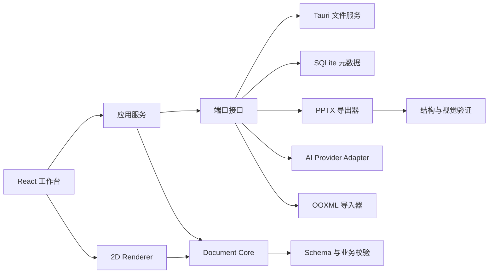

# PPTD 系统架构

## 1. 目标与范围

本文将 TRS V1.0 转换为可实施的架构边界。首个迭代 V0.1 的闭环为：创建项目、编辑文本/图片/形状、撤销重做、保存恢复并导出可打开的 PPTX。

架构采用“纯领域核心 + 端口适配器”方式。文档模型和命令处理保持与 React、Tauri、PptxGenJS、SQLite 解耦，使同一份文档可被编辑器、缩略图、校验器和导出器消费。

## 2. 逻辑架构

依赖只能指向领域核心：适配器可以依赖端口和模型，核心不能依赖 UI、Tauri 或具体 AI/PPTX 库。

## 3. 模块职责

### AI PPT Workbench

`src/workbench` 是 AI 操作 PPT 的独立中间层，不属于 React feature，也不属于领域核心。AI Provider Adapter 只能通过该模块公布的带命名空间工具读取能力和提出操作；Workbench 将未知模型输入解析为受控布局程序或强类型领域命令，再交给应用事务边界执行。

纯坐标和布局算法位于 `src/core/layout/geometry`，供领域配方与 Workbench 共同使用。依赖方向固定为 `AI Adapter -> workbench -> core`，`core` 不得反向依赖 Workbench。详细约束见 [ADR 0113](decisions/0113-ai-ppt-workbench-boundary.md)。

| 模块                       | 职责                                                            | 明确边界               |
| -------------------------- | --------------------------------------------------------------- | ---------------------- |
| `core/document-model`      | 实体、值对象、Schema、迁移                                      | 不访问文件、网络和 UI  |
| `core/commands`            | 文档命令、事务、不变量、撤销补丁                                | 不直接渲染             |
| `core/validation`          | 结构、内容状态、溢出和导出前校验                                | 不修改文档             |
| `core/design/taste-lint`   | 确定性设计体检：字号、字阶、字体/色彩数量、模板装饰、节奏与留白 | 只读、不阻断、不持久化 |
| `core/rendering`           | 坐标、几何、文本测量接口                                        | 不保存状态             |
| `features/editor`          | 选择、变换、文本编辑、页面操作                                  | 通过命令修改模型       |
| `features/project`         | 新建、打开、保存、恢复、最近项目                                | 通过持久化端口访问数据 |
| `features/pptx-export`     | 导出计划及对象映射                                              | 不承担 PPTX 导入       |
| `features/template-import` | OOXML 解析和兼容报告                                            | V0.2 启用              |
| `features/ai-content`      | 内容提案、审核和内容版本                                        | V0.4 启用              |
| `features/ai-design`       | 设计提案和版本冲突检查                                          | 禁止直接修改内容字段   |
| `features/scene3d`         | 场景、预览和栅格化导出                                          | V0.5 启用              |
| `src-tauri`                | 系统窗口、受控文件访问、原子写入                                | 不承载前端领域规则     |

## 4. 运行时数据流

### 4.1 编辑事务

1. UI 将指针或表单交互转换成领域命令。
2. 命令处理器校验目标对象、锁定状态和参数范围。
3. 处理器生成下一文档状态及可逆补丁。
4. Store 一次性提交事务，递增对应 revision。
5. 渲染器通过选择器读取变更范围并更新视图。
6. 自动保存仅持久化已提交的事务，拖拽过程中的瞬时状态不写盘。

高频拖拽使用临时交互状态；在 `pointerup` 时提交一个 `TransformElements` 命令，避免撤销栈和磁盘被鼠标事件淹没。

### 4.2 保存与恢复

项目文件以带 `schemaVersion` 的 JSON 文档为事实来源，大型资源使用内容哈希命名并单独存储。保存流程为“写临时文件 → 刷盘 → 原子替换”。SQLite 只保存项目索引、最近打开记录、版本元数据和资源引用，不保存无法独立恢复的唯一文档副本。

异常恢复区保存最后一次自动保存快照和未正常关闭标记。成功打开正式项目后再清理对应恢复记录。

### 4.3 本地数据库

应用数据目录下的 `pptd.sqlite3` 保存两类本地状态：

- `app_settings`：主题、AI 厂商和模型选择。API Key 仍只存在操作系统凭据库。
- `ai_draft_history`：AI 内容草稿历史，按更新时间保留最近 20 条。

项目正文和资源仍以 `.pptd` 文件及项目资源目录为真源，数据库不保存唯一的文档副本。Schema 通过 `PRAGMA user_version` 迁移；打开比当前版本更新的数据库会返回稳定错误，而不是猜测结构。浏览器预览模式没有本地数据库，读写回退到默认值或明确提示，不使用 localStorage 或 IndexedDB 作为替代存储。

失败诊断不写进数据库：生成、设计、导出和保存的失败追加到系统日志目录下的 `logs/app.log`（JSONL，一行一条，记录错误码、失败阶段和计数，不含正文、备注或图片）。单文件 2 MB 后轮转为 `app.log.1`；左侧导航“日志”面板可读最近 200 条，设置页显示该文件位置。见 [ADR 0088](decisions/0088-diagnostic-log.md)。

### 4.4 PPTX 导出

导出分为四步：文档校验、生成不可变导出计划、映射到 PptxGenJS、验证 ZIP/OOXML 结构。导出器只读取文档快照；导出失败不能改变项目。每次导出产生包含警告、降级和字体问题的报告。

## 5. 进程与安全边界

WebView 仅通过窄接口调用 Tauri command。文件命令接收已规范化的项目 ID 或由系统文件选择器返回的授权路径；Rust 端再次校验允许的扩展名、路径范围和文件大小。API Key 存入操作系统安全凭据设施，项目文档、前端状态和日志只保存凭据引用。

导入的 PPTX、XML、图片和文本均是不可信输入。OOXML 解包必须限制文件数、单文件大小、总展开大小、压缩比、关系深度和外部关系，不执行宏或嵌入脚本。

## 6. 关键技术决定

| 决定     | 选择                           | 原因                                 |
| -------- | ------------------------------ | ------------------------------------ |
| 领域标识 | UUID/ULID 字符串               | 跨离线副本稳定，避免数组索引成为引用 |
| 内部长度 | 整数 EMU                       | 与 OOXML 对齐，避免浮点往返漂移      |
| 文档校验 | TypeScript Schema + 领域不变量 | 同时覆盖外部数据和跨字段规则         |
| 状态更新 | 命令 + Immer patch             | 支持事务、撤销、审计和增量保存       |
| 项目真源 | 版本化 JSON + 资源目录         | 易迁移、可诊断、可恢复               |
| 元数据   | SQLite                         | 适合索引、历史和查询，不绑死文档格式 |
| 标准导出 | PptxGenJS                      | V0.1 原生对象导出成本可控            |
| 保真往返 | 独立 OOXML 适配层              | 避免误用 PptxGenJS 承诺完整保真      |

## 7. 架构验收

- 核心包的单元测试无需浏览器和 Tauri 即可运行。
- 同一测试文档在画布、缩略图和导出计划中使用相同坐标和对象顺序。
- 设计命令对 `ContentModel` 的序列化结果保持字节级等价。
- 保存中断后，原项目文件仍可打开；恢复区能识别较新的自动保存版本。
- 导出失败返回可诊断错误与报告，不改变文档 revision。

## 8. 模板高保真渲染边界

复杂模板采用“固定视觉层 + 可编辑内容层”的双层策略。Windows 高保真模式由 Microsoft PowerPoint 渲染空白 `CustomLayout`，保留背景图片、渐变、自由形状、Logo 和复杂母版继承；输出作为锁定背景图片，标题和正文继续使用原生可编辑对象。

PowerPoint 是当前高保真适配器，而不是模板功能的唯一架构依赖。长期回退顺序为 PowerPoint、LibreOffice、PPTD 内置基础解析器和安全默认布局。PowerPoint 不可用时必须显示降级原因。详细决策见 [`0002-template-rendering-adapters.md`](decisions/0002-template-rendering-adapters.md)。
