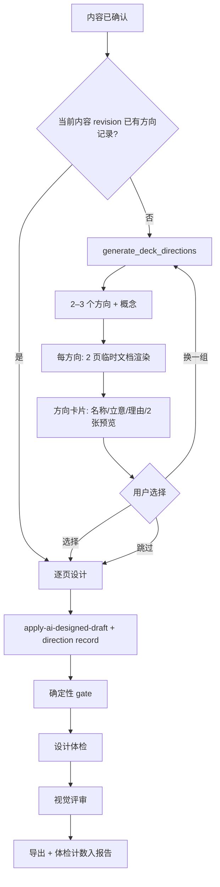

# TASK-DESIGN-025：设计方向、样张与确定性品味检查

| 项目     | 内容                                                                                                                                                              |
| -------- | ----------------------------------------------------------------------------------------------------------------------------------------------------------------- |
| 状态     | 草案（待评审，2026-10-24）                                                                                                                                        |
| 优先级   | P0                                                                                                                                                                |
| 里程碑   | V0.4 设计能力                                                                                                                                                     |
| 预估     | 10–13 人日                                                                                                                                                        |
| 依赖     | ADR 0013（样式片段）、ADR 0015（不阻断）、ADR 0046（概念与配方）、ADR 0060（设计快照）、ADR 0070（设计计划编译器）                                                |
| 需求依据 | [PPTD 设计方向与品味门 需求说明 v0.1](../../requirements/PPTD-Design-Direction-TRS-v0.1.md) FR-D1–FR-D5、C-1–C-7                                                  |
| 影响范围 | `core/design`、`core/document-model`、`core/commands`、`services/ai-*`、`features/ai`、`features/pptx-export`、`tools/design-preview`、`src-tauri/commands/ai.rs` |

## 1. 背景与现状

设计阶段的三个结构性缺口已经在需求文档 1.1 中列出。与本任务直接相关的代码事实：

1. **方向只有一个实现。** `ConceptPresetId` 是字面量 `"editorial"`，`resolveDeckConcept` 把其他值降级并记 conflict（`src/core/design/deck-concept.ts:15`、`:129`）。
2. **提案数量被写死为一个。** `generateDeckConcepts` 在数量不等于 1 时抛错（`src/services/ai-service.ts:1356`），尽管函数名与返回类型是复数。
3. **生成是单次整册。** 内容确认后直接 `generateDeckConcepts` → `generatePresentationDesign` → `applyCommand`，中间没有选择步骤（`src/app/App.tsx:2971`–`3002`、`:3174`）。
4. **已有可复用的确定性夹具与渲染器。** `tools/design-preview/fixture.ts` 构造覆盖 12 个配方的十页文档，但 `themePresetId` 硬编码为 `editorial-teal`；`renderPresentationForVisualReview` 可把文档渲染成逐页 JPEG 与 contact sheet。
5. **已有“临时单页渲染”的先例。** `relayoutSlide` 用临时文档 + `pageContext` 重排单页（`src/core/commands/commands.ts:1388`–`1433`），方向预览应复用同一路径而不是新写渲染器。
6. **确定性 gate 不含品味规则。** `presentation-quality-gate.ts:6` 的 7 类问题全是几何与对比度；字号下限、字阶比、字体/色彩数量、模板装饰均无检查。
7. **概念字段尚未被消费。** `motif` / `surface` / `imagery` 只写入合同与文档，渲染路径只读取 `typeContrast`（`src/core/design/design-tokens.ts:33`）。因此“新增一个 preset”本身不会产生可见差异，P0 必须同时接线（见 4.1.1）。

## 2. 目标与范围

### 2.1 目标

1. 增加第二个可完整渲染的概念预设，让“方向”有真实的视觉差异。
2. 在整册设计之前提供 2–3 个方向，每个方向 2 页真实预览；用户选择、换一组或跳过。
3. 把选择写入项目，可回看、可撤销，且不污染内容版本。
4. 让 11 套主题预设各有 8 页样张，并接入选择器与回归夹具。
5. 提供确定性设计体检，输出可定位的硬底线与软提示，不阻断生成与导出。

### 2.2 包含

- `ConceptPresetId` 扩充与 `resolveDeckConcept` 语义调整。
- `surface` / `imagery` / `typeContrast` 接入渲染路径（4.1.1），确保两个预设产生结构差异。
- `DesignDirectionRecord` 及其 Schema 19 → 20 迁移。
- `apply-ai-designed-draft` 接受可选方向记录。
- Rust 方向提案命令、TS Schema 校验与归一化。
- 方向预览（临时文档 + 每页 `pageContext`）。
- 设计方向 UI 步骤（选择 / 换一组 / 跳过 / 取消）。
- 样张夹具参数化、11 套样张生成与清单。
- `core/design/taste-lint.ts` 与规则集。
- 体检面板、导出报告计数。
- 测试、ADR、README 同步。

### 2.3 不包含（本轮）

- 设计记忆、资产来源、导出回读（P1，见需求 FR-D6–FR-D8）。
- 概念分、数据页关系、渲染器证据等级、提示词回归套件（P2）。
- 方向收藏、按方向重排整册、方向与模板的自动匹配学习。
- 自由布局、任意坐标、HTML 设计真源。
- 视觉评审合同的任何破坏性变更。

## 3. 总体设计



关键取舍：**方向预览必须走真实编译器**。任何“用示意卡片代替真实渲染”的做法都会让用户选到无法落地的方向；预览与最终页面必须能被同一条断言比较（见 §8 的 parity 测试）。

## 4. 领域模型与持久化

### 4.1 概念预设扩充

`src/core/design/deck-concept.ts`：

```ts
export type ConceptPresetId = "editorial" | "documentary";

interface ConceptPreset {
  motif: DeckMotif;
  surface: SurfaceStrategy;
  recipes: readonly RecipeId[];
  /** 该预设允许的图像策略；解析时按白名单收敛，而不是固定单一值。 */
  imagery: readonly ImageryStrategy[];
  typeContrast: TypeContrast;
}
```

- `editorial` 保持现有实现：`motif: "rules"`、`surface: "rules"`、`imagery: ["none", "side"]`（当前实际只用到 `side`）。
- 新增 `documentary`：`motif: "documentary"`、`surface: "full-bleed"`、`imagery: ["hero", "band", "side"]`、`typeContrast: "calm"`、12 个配方全量。
- `AiDeckConcept.imagery` 仍是单值；`resolveDeckConcept` 校验它是否在预设白名单内，不在则回退到白名单首项并记 conflict。
- 未知 preset 仍回退 `editorial` 并记 conflict，保持旧行为。
- `CONCEPT_PRESET_IDS` 由实现表派生，模型合同引用同一常量，避免“合同有值、渲染器画不出”。

**为什么不是只改配色**：`editorial` 与 `documentary` 的表面策略、图像策略、字阶对比必须不同，否则方向卡片只是同一骨架的两种色板，违反需求 FR-D3。

### 4.1.1 让方向字段真正生效

现状：`DeckConcept` 的 `motif`、`surface`、`imagery` 只被存储，没有进入渲染路径；只有 `typeContrast` 通过 `design-tokens.ts` 影响展示/标题字号。**只新增一个 preset 不会产生任何可见差异**，P0 必须同时接线：

1. **typeContrast（已有）**：`CONTRAST_FACTORS` 决定 display/title 比例；确认 `calm` 与 `strong` 在 13.33in 页面上差异可辨（标题字号差 ≥ 15%）。
2. **imagery**：在命令层把 `design.visualAsset.role` 收敛到 `concept.imagery` 白名单。`editorial` 只允许 `side`（保持现状），`documentary` 允许 `hero` / `band` / `side`；`image-led` 配方仅在 `hasAsset` 且角色被允许时使用（`src/core/layout/recipes/plan.ts:32`、`src/core/layout/recipes/image-led.ts:29`）。不被允许时降级为 `side` 或退回无图配方，并记 conflict。
3. **surface**：在 `planPageChrome` 的调用点按 `surface` 选择边距档位。`rules` 保持现有标题轴与内容区；`full-bleed` 收窄外边距（标题区上移、内容区左右外扩一档），`showRule` 交给配方决定。页面已有模板安全区时模板优先，`surface` 不覆盖模板占位区。

`motif` 本轮只作为元数据保存，不参与渲染，也不写进对外承诺。方向差异由表面策略、图像策略与字阶对比承担。

**验收**：同一份十页夹具分别用两个预设生成，元素序列、页边距、图像角色这三类中至少两类不同；只有颜色或字号不同视为不通过。

### 4.2 方向记录

```ts
// src/core/document-model/types.ts
export interface DesignDirectionProposal {
  id: string;
  preset: ConceptPresetId;
  name: string;
  idea: string;
  rationale: string;
  typeContrast: TypeContrast;
  imagery: ImageryStrategy;
  /** 预览页在真实文稿中的页码与内容指纹，用于判断预览是否过期。 */
  previewPages: Array<{ index: number; contentFingerprint: string }>;
}

export interface DesignDirectionRecord {
  id: string;
  createdAt: string;
  contentRevision: number;
  contentFingerprint: string;
  proposals: DesignDirectionProposal[];
  selectedProposalId: string;
  selectedBy: "user" | "fallback";
  userWords?: string;
  regenerations: number;
  promptVersion: string;
  model?: string;
  /** 方向决策只属于设计态，永不进入内容哈希。 */
}

export interface PresentationDocument {
  // ...
  designDirections?: DesignDirectionRecord[]; // 最多 20 条，超出丢弃最旧
}
```

内容指纹复用现有实现：`documentContentFingerprint`（`src/services/design-quality-stage.ts`）是纯函数但位于 services 层。实施时先把它移动到 `src/core/commands/content-fingerprint.ts`，services 改为从 core 导入；不得在 core 内反向依赖 services。

`DesignDirectionRecord` 与 `ReviewTrace` 的区别：前者是用户决策，后者是评审结果；两者都不进入内容哈希，都按上限裁剪。

### 4.3 Schema 迁移 19 → 20

- `CURRENT_SCHEMA_VERSION` 从 19 改为 20（`src/core/document-model/schema.ts:6`）。
- 迁移为恒等迁移：旧文档补 `designDirections: []`，其余字段不动。
- 复用现有输入样例 `src/core/document-model/__fixtures__/v19-document.json`（本就没有 `designDirections`），新增迁移结果样例 `v20-document.json`；断言迁移后版本为 20、方向数组为空、内容哈希不变。
- `schema.ts` 增加 `designDirectionSchema`；`idea` 1–80、`name` 1–12、`proposals` 2–3、`regenerations` 0–2、`proposals[].preset` 必须属于 `CONCEPT_PRESET_IDS`。

### 4.4 revision 与内容哈希

- 预览：只操作内存中的临时文档，不调用 store，不产生 patch。
- 应用：`apply-ai-designed-draft` 一次事务内写入设计元素与方向记录，产生**一个**撤销项，`designRevision` +1。
- `designDirections` 不属于内容字段，不参与 `contentHash`；应用后必须断言 `contentHash` 与 `contentRevision` 未变（已有内容已确认，设计应用不得改动内容）。
- 撤销该命令时，方向记录随文档回滚。命令本身按 `both` 分类（它同时写入内容与设计），因此 patch 生成处必须显式把方向记录归入设计态变更，不能让它参与内容 revision 统计。

## 5. 方向提案

### 5.1 模型合同（Rust）

新增命令 `generate_deck_directions`（`src-tauri/src/commands/ai.rs`，与 `generate_deck_concepts` 并列）：

```rust
pub struct GenerateDeckDirectionsRequest {
    pub draft: AiDraft,
    pub briefs: Vec<SlideBrief>,
    pub template: DesignTemplateContext,
    pub visual_goal: PresentationVisualGoal,
    pub theme_direction: Option<ThemeDirection>,
    /// 最近项目的设计指纹摘要，仅用于去重；不含正文。
    pub recent_looks: Option<Vec<RecentLook>>,
    pub model: String,
    pub provider: String,
    pub task_id: Option<u32>,
    pub stream_progress: Option<bool>,
}
```

输出：

```json
{
  "directions": [
    {
      "preset": "editorial",
      "name": "编辑部",
      "idea": "用细线和大字号把结论排成社论版面。",
      "rationale": "内容以判断和要点为主，图片少。",
      "typeContrast": "strong",
      "imagery": "none"
    }
  ]
}
```

提示词硬规则：

1. 只输出 2–3 个方向，`preset` 必须互不相同且在允许列表内。
2. `name` 不超过 12 字；`idea` 1–80 字，只说视觉策略，不复述标题；`rationale` 不超过 120 字，说明与内容的匹配。
3. 禁止输出页面文案、坐标、字号、颜色值或元素清单。
4. 方向差异必须落在表面策略、字阶对比或图像策略上，不能只换配色。
5. 提供 `recent_looks` 时，避免与最近 3 个项目的外观家族重复。
6. 只输出一个 JSON 对象，不要 Markdown 或解释。

超时沿用设计阶段预算（180 秒），取消走 `task_id` 广播，进度阶段复用 `"design"`，界面文案区分“生成方向”和“生成逐页设计”。

### 5.2 校验与归一化（TS）

`src/services/ai-service.ts`：

```ts
export async function generateDeckDirections(
  draft: AiDraft,
  briefs: SlideBrief[],
  template: DesignTemplateContext,
  options: { taskId?: number; themeDirection?: ThemeDirection; recentLooks?: RecentLook[] },
): Promise<AiDeckDirection[]>;
```

校验顺序（任一失败抛 `AI_DIRECTIONS_INVALID`，保留原始错误信息到诊断上下文）：

1. 数量 2–3；
2. `preset` 唯一且属于 `CONCEPT_PRESET_IDS`；
3. `name`、`idea`、`rationale` 长度与去空白；
4. `typeContrast` 属于枚举；
5. `imagery` 属于该预设白名单。

归一化只做三件事：`trim`、折叠连续空白、按 `CONCEPT_PRESET_IDS` 顺序稳定排序（保证 UI 顺序可复现）。不补造缺失方向、不改写文案。

### 5.3 两页预览

选页规则：

- 第 1 页固定为封面（`slides[0]`）。
- 第 2 页取第一个满足“有结构化内容块或正文 ≥ 60 字”的正文页；没有则取 `slides[1]`。

流程（每个方向一次）：

1. 从真实文档取两页的 `AiSlideDraft` 与 `SlideBrief`，构造临时 `AiDraft`（标题与页序保持真实）。
2. 调 `generatePresentationDesign(previewDraft, previewBriefs, analysis, { concept })`，得到 2 页设计。**这是方向阶段唯一的新增模型调用**；N≤3 时为 2N 页设计量。
3. 对每一页复用 `inferRelayoutContext(slide, document)`（`src/core/commands/slide-relayout.ts:293`）得到模板上下文；创建临时单页文档（`createDocument` + `pageSize` + `theme` + `layouts`），先 `apply-ai-draft` 写入该页内容，再 `apply-ai-designed-draft` 写入该页设计，并传入真实 `pageContext: { index, total, sectionLabel }`。
4. `renderPresentationForVisualReview(tempDoc, 1280)` 取 `slides[0]` 作为预览图；两页拼成一张卡片预览（复用 `composeContactSheetFromDataUrls` 或直接并排两张）。
5. 释放临时文档与图片 URL；不写入 store，不修改真实文档。

**为什么用临时单页而不是克隆整册**：`apply-ai-designed-draft` 要求 `slides.length === designs.length`；整册克隆需要一次设计 20 页，成本与方向阶段上限冲突。逐页临时渲染与 `relayoutSlide` 同路径，页码/章节名通过 `pageContext` 保持真实，差异最小。

已知限制（必须写进 UI 文案与测试容忍）：预览是“代表性页面”，不是最终整册的逐像素副本；页脚、页码、章节名以外的跨页节奏（例如上一页的章节来源）可能与最终稿有 1 级差异。

### 5.4 UI 状态机

`features/ai` 内新增纯状态模块 `design-direction-flow.ts`（无 React），由 App 调用：

```ts
type DirectionFlowState =
  | { stage: "idle" }
  | { stage: "generating"; startedAt: number }
  | { stage: "ready"; proposals: DirectionProposal[]; regenerations: number; previews: DirectionPreview[] }
  | { stage: "applying"; selectedId: string }
  | { stage: "skipped"; regenerations: number }
  | { stage: "failed"; code: string; message: string };
```

规则：

- `regenerations` 上限 2；达到上限后“换一组”禁用并提示。
- 选择后进入 `applying`，若整册设计失败，允许回到 `ready` 重选（不消耗 `regenerations`）。
- 跳过写入 `selectedBy: "fallback"`；接口失败**不写记录**，只提示，下次生成重新询问。
- 取消：调用 `cancelAiGeneration(taskId)`，状态回 `idle`，不写文档。
- 键盘：方向卡片是 `radiogroup`，左右切换，Enter 确认，Esc 取消；缩略图 `alt` 为“方向名：立意”。

## 6. 样张

### 6.1 夹具参数化

`tools/design-preview/fixture.ts`：

```ts
export function buildDesignPreviewDocument(options?: {
  themePresetId?: string; // 默认 editorial-teal
  conceptPresetId?: ConceptPresetId; // 默认 editorial
}): PresentationDocument;
```

保持现有默认值，确保已有测试不变。内部把硬编码的 `themePresetId` 与 `defaultEditorialConcept()` 改为参数。

### 6.2 样张的形态

样张首先是**文档夹具**，不是图片。`tools/design-preview/specimens.ts` 导出：

```ts
export function buildSpecimenDocument(options: {
  themePresetId: string;
  conceptPresetId: ConceptPresetId;
}): PresentationDocument;
```

- 8 页固定结构（封面、章节、正文、指标、表格、图表、图片、结论），内容来自固定夹具，不调用模型。
- 页面尺寸取内置 16:9；主题通过 `themePresetId` 注入，概念通过命令的 `designConcept` 注入。
- 纯 Node 可构造：不依赖 DOM，也不依赖 PptxGenJS。

**不在仓库入库 JPEG。** 现有渲染器 `presentation-renderer.ts` 依赖浏览器 canvas，Node 测试环境没有 DOM；为了几张图引入 Playwright 或 Office，会把样张生成变成环境依赖。改为：

- **选择器按需渲染**：用户聚焦某套预设时，才在应用内调 `renderPresentationForVisualReview(specimen, 640)` 渲染该套 8 页（或先只渲染封面），结果按 `themePresetId + conceptPresetId + schemaVersion` 缓存在内存。
- **README / 发布材料**如需静态图，由人工在应用内导出 contact sheet 后提交，属于发布流程，不是 CI 步骤。
- **视觉回归**继续走 `tools/visual-regression` 的 PowerPoint / LibreOffice 基线，不新建图片管线。

清单 `tools/design-preview/specimens.manifest.json` 只记录结构信息：预设 ID、8 页页序与 recipe、页面尺寸、夹具版本；不记录图片路径。测试在 Node 中直接比较页数、recipe 覆盖与元素数量。

### 6.3 消费方

- `features/ai/ThemePresetPicker`：聚焦或选中时请求样张预览；渲染中显示骨架屏；失败退回现有色板卡片，不显示空白。
- 方向提案：只传样张的结构摘要（recipe 序列、密度、图像策略），不传图片。
- 导出兼容测试：同一份 specimen 文档执行 `buildPptx`，断言 8 页对象类型与清单一致。

## 7. 设计体检

### 7.1 模块与 API

`src/core/design/taste-lint.ts`（纯函数，禁止依赖 React/Tauri/PptxGenJS）：

```ts
export type TasteSeverity = "hard" | "soft";
export type TasteIssueCode =
  | "BODY_TEXT_TOO_SMALL"
  | "LABEL_TEXT_TOO_SMALL"
  | "TITLE_BODY_RATIO_LOW"
  | "FONT_FAMILY_COUNT"
  | "COLOR_COUNT"
  | "DECORATION_KICKER"
  | "DECORATION_INDEX_NUMBER"
  | "DECORATION_EMOJI"
  | "DECORATION_ACCENT_WORD"
  | "RHYTHM_REPEAT"
  | "WHITESPACE_IMBALANCE";

export interface TasteIssue {
  code: TasteIssueCode;
  severity: TasteSeverity;
  slideIndex: number;
  slideId: string;
  elementIds: string[];
  message: string;
  metrics?: Record<string, number | string>;
  suggestion?: string;
}

export interface TasteReport {
  issues: TasteIssue[];
  counts: Record<TasteIssueCode, number>;
  /** 无法判定的检查项，例如“模板底图内的装饰”。必须显示为未覆盖。 */
  skipped: string[];
  checkedAt: string;
}

export function lintTaste(
  document: PresentationDocument,
  options?: { pageRoles?: readonly string[]; minBodyPt?: number },
): TasteReport;
```

排序：`severity`（hard 优先）→ `slideIndex` → `code` → `elementIds.join()`。保证同一文档输出可深度比较。

### 7.2 阈值推导

页宽 pt = `document.pageSize.width / 12_700`（EMU/pt）。

| 规则                      | 级别 | 阈值                                                                                                 | 依据                                                                                                   |
| ------------------------- | ---- | ---------------------------------------------------------------------------------------------------- | ------------------------------------------------------------------------------------------------------ |
| `BODY_TEXT_TOO_SMALL`     | hard | 正文/段落字号 < `max(12, 0.0125 × 页宽pt)`                                                           | 13.33in 页（960pt）→ 12pt；26.67in 页（1920pt）→ 24pt。按页宽比例而不是固定 px，避免不同页面尺寸下失效 |
| `LABEL_TEXT_TOO_SMALL`    | hard | 标签/注释字号 < `max(9, 0.008 × 页宽pt)`                                                             | 同上，标签允许比正文小一档                                                                             |
| `TITLE_BODY_RATIO_LOW`    | hard | 标题/正文 < 2.5，且正文 ≥ 20 字                                                                      | 层级需要可辨；短标题页（封面）不判                                                                     |
| `FONT_FAMILY_COUNT`       | soft | 去重字体族 > 2                                                                                       | 主题主/次字体不计入“额外字体”                                                                          |
| `COLOR_COUNT`             | soft | 非中性色 > 4                                                                                         | 饱和度 < 0.12 视为中性；同时统计填充、描边、文字色                                                     |
| `DECORATION_KICKER`       | soft | 标题上方短标签：字号 < 0.45×标题、垂直距离 < 1.8×标题高、水平左缘差 < 5% 页宽、长度 ≤ 24、无句末标点 | 对应“每个标题上一行全大写小标签”                                                                       |
| `DECORATION_INDEX_NUMBER` | soft | 独立 `^0?\d{1,2}$` 文本，且本页无 process/timeline/有序列表块                                        | 编号只在真是序列时使用                                                                                 |
| `DECORATION_EMOJI`        | soft | 文本命中 `\p{Extended_Pictographic}`                                                                 | emoji 图标不在内置图标库内                                                                             |
| `DECORATION_ACCENT_WORD`  | soft | 标题内仅一个 run 变色，run 词数 < 总词数/2，且总词数 ≥ 3                                             | 对应“标题里只给一个词换色”                                                                             |
| `RHYTHM_REPEAT`           | soft | 连续 ≥3 个内容页使用相同 `(layout, recipe)`                                                          | 跳过封面、章节、结论                                                                                   |
| `WHITESPACE_IMBALANCE`    | soft | 非背景元素外接框覆盖页面比例 > 0.92×0.90，或 < 0.12                                                  | 粗代理，只作提示；精确留白交给视觉评审                                                                 |

实现细节：

- 颜色分析新增 `src/core/rendering/color-analysis.ts`：`hexToHsl`、`isNeutralHex`、`hueDistance`。不引入新依赖。
- 字体族比较前先做别名归一（`微软雅黑` / `Microsoft YaHei` 视为一个），新增 `src/core/design/font-alias.ts` 存放别名表。现有 `src/services/font-availability.ts` 只做安装探测，没有别名表，不能直接复用；core 不得依赖 services。
- 文本 run 解析复用 `textFragments` 与 `resolveFragmentStyle`（`core/document-model`）。
- 模板底图（`placement: "layout-background"`）不参与颜色统计；全页底图页面跳过 `WHITESPACE_IMBALANCE` 与 `COLOR_COUNT`，并在 `skipped` 中记录原因。

### 7.3 与现有 gate、评审、导出的关系

- **不合并**：`validatePresentationVisualQuality` 仍是几何/对比度硬门；体检是独立报告，不改变 gate 的 `passed`。
- **不阻断**：遵循 ADR 0015，体检结果不阻断生成、不阻断导出、不自动修复。
- **不持久化**：体检是确定性函数，重新打开项目时重算即可，不新增 Schema 字段；导出报告保存当次快照计数。
- **导出报告**：新增 `tasteLint: { hard: number; soft: number; codes: Record<string, number> }`。字段缺失时按“未执行”展示，不补 0。
- **视觉评审**：体检不产生分数；概念分属于 P2，本轮不做。

### 7.4 呈现

- 右侧检查器新增“体检”页签；默认折叠，首次应用设计后显示角标（硬底线数量）。
- 列表按级别分组；每条显示消息、度量值与“定位”按钮（选中页与元素）。
- 底部固定说明：“仅提示，不影响生成与导出；像素级问题由视觉评审负责。”
- 空状态与异常状态区分：无问题显示“未发现问题”；执行失败显示 `TASTE_LINT_UNAVAILABLE`，不得显示通过。

## 8. 测试计划

| 层     | 文件                                           | 覆盖                                                                                                    | CI   |
| ------ | ---------------------------------------------- | ------------------------------------------------------------------------------------------------------- | ---- |
| 领域   | `src/core/design/deck-concept.test.ts`         | 两个预设解析、imagery 白名单收敛、未知 preset 回退并记 conflict；十页夹具双预设至少两类结构差异         | 是   |
| 领域   | `src/core/design/taste-lint.test.ts`           | 11 条规则各 1 例、阈值边界（11.9/12.1pt）、确定性（两次深比较）、十页夹具零误报                         | 是   |
| 领域   | `src/core/design/direction-preview.test.ts`    | 临时文档页数/页序/`pageContext` 正确、渲染不修改真实文档、两方向预览几何不同                            | 是   |
| Schema | `src/core/document-model/schema.test.ts`       | 19 → 20 恒等迁移、固定样例、非法方向记录被拒                                                            | 是   |
| 命令   | `src/core/commands/commands.test.ts`           | 方向记录追加/上限 20/撤销回滚/`contentHash` 与 `contentRevision` 不变/过期返回 `DESIGN_DIRECTION_STALE` | 是   |
| 服务   | `src/services/ai-service.test.ts`              | 2–3 个方向合法、重复 preset 拒绝、长度越界拒绝、未知 preset 拒绝、失败码 `AI_DIRECTIONS_INVALID`        | 是   |
| 夹具   | `tools/design-preview/design-preview.test.ts`  | specimen builder 对 11 套预设各产出 8 页，recipe 覆盖与清单一致；不依赖 DOM                             | 是   |
| 导出   | `src/features/pptx-export/export-pptx.test.ts` | 报告包含体检计数；无体检时不写 0                                                                        | 是   |
| 回归   | `tools/visual-regression`                      | 样张像素基线（按渲染器分目录，`PPTD_SKIP_VISUAL=1` 跳过）                                               | 条件 |

关键断言：

1. **预览零副作用**：预览前后 `structuredClone(document)` 深度相等（含 `revisions`、`contentVersions`）。
2. **预览与最终一致**：同一方向、同一页的预览元素框与整册应用后的元素框，归一化坐标差 ≤ 0.005 页宽。
3. **内容隔离**：应用方向后 `contentHash` 不变；修改标题后应用旧记录返回 `DESIGN_DIRECTION_STALE`。
4. **确定性**：体检对同一文档连续执行两次，`JSON.stringify` 结果一致。
5. **降级诚实**：样张缺失、体检异常、方向失败三种情况下，界面与报告都显示“未执行/不可用”，不显示通过。

手工验证（仓库惯例，截图存 `.tmp/`）：

- 方向选择页：3 个方向 × 2 页预览，键盘可操作。
- 两个预设的封面与正文并排对比，能看出骨架差异而不只是配色。
- 体检面板：点击问题定位到正确页与元素。
- 导出报告：体检计数与实际一致。

## 9. 实施步骤

| 步骤 | 内容                                                                                                           | DoD                                                                                              | 预估 |
| ---- | -------------------------------------------------------------------------------------------------------------- | ------------------------------------------------------------------------------------------------ | ---- |
| P0-1 | 扩充 `ConceptPresetId` 与 `documentary`；接线 `imagery` 白名单与 `surface` 边距档位；调整 `resolveDeckConcept` | 两个预设在同一夹具上至少两类结构不同（元素序列/页边距/图像角色）；旧测试不改语义；冲突有稳定原因 | 1.5d |
| P0-2 | Schema 19 → 20、`designDirections`、固定样例、命令字段与 patch 归属                                            | 迁移测试通过；应用前后内容哈希不变；撤销回滚                                                     | 0.5d |
| P0-3 | Rust `generate_deck_directions` + 提示词 + TS Schema 校验                                                      | 合法输出可解析；非法输出稳定报错；进度与取消可用                                                 | 1.5d |
| P0-4 | 方向预览：临时单页文档 + `inferRelayoutContext` + `pageContext` + 渲染                                         | 两页预览可出图；零副作用；预览/最终 parity 断言通过                                              | 1.5d |
| P0-5 | 方向选择 UI 与状态机                                                                                           | 选择/换一组/跳过/取消全路径；键盘可用；失败回退单方向                                            | 2d   |
| P0-6 | 夹具参数化、specimen builder、选择器按需预览                                                                   | 11 套预设可构建 8 页；预览可渲染且失败降级；清单校验通过                                         | 1.5d |
| P0-7 | `taste-lint` 核心与 11 条规则                                                                                  | 规则单测与边界通过；十页夹具零误报（阈值可调）                                                   | 2d   |
| P0-8 | 体检面板、导出报告字段                                                                                         | 定位可用；导出计数正确；异常显示未执行                                                           | 1d   |
| P0-9 | 测试补齐、ADR、README、架构文档同步                                                                            | 全量测试/类型/lint/构建通过；文档链接有效                                                        | 1d   |

建议顺序：P0-1 → P0-2 → P0-3 → P0-4 → P0-5 → P0-6 → P0-7 → P0-8 → P0-9。P0-7 可与 P0-5 并行，P0-6 可与 P0-3 并行。

## 10. 风险与回退

| 风险                  | 影响                     | 缓解                                                                                                                              |
| --------------------- | ------------------------ | --------------------------------------------------------------------------------------------------------------------------------- |
| 预览与最终不一致      | 用户选中的方向落地后变样 | 复用真实编译器与 `pageContext`；加 parity 断言；UI 明示“代表性页面”                                                               |
| 方向差异仍然只是配色  | 选择环节无价值           | `documentary` 必须在表面策略/图像策略/字阶上不同，并实际接线（4.1.1）；先做需求文档第 13 节盲选验证；不达标就回退流程，优先改配方 |
| 方向阶段成本过高      | 生成变慢、token 增加     | 上限 2 页 × 3 方向；只设计一次 2 页草案；缓存按内容指纹；可关闭                                                                   |
| 体检误杀              | 用户被无意义提示干扰     | 只做软提示；十页夹具零误报作为门槛；规则可单独禁用                                                                                |
| Schema 变更破坏旧项目 | 打开失败                 | 可选字段 + 恒等迁移 + 固定样例；旧文档无记录走原路径                                                                              |
| 模型输出不稳定        | 方向缺失或重复           | Schema 校验 + 归一化 + 失败回退单方向；不补造内容                                                                                 |
| 样张按需渲染卡顿      | 打开选择器变慢           | 只渲染聚焦项与封面、宽度 640、内存缓存、失败退回色板                                                                              |
| UI 阻塞主流程         | 无法继续                 | 可跳过、可取消、失败自动回退；不设置强制等待                                                                                      |

回退开关（设置项，默认开启）：

- `designDirections: "auto" | "off"`：关闭后完全走现有单方向路径。
- `tasteLint: "on" | "off"`：关闭后不显示体检页签，导出报告不写该字段。

## 11. 文档与 ADR

实施前需要新增（编号顺延当前最大 0074）：

1. `docs/architecture/decisions/0075-design-direction-proposal-and-selection.md`
   - 方向是设计态事实；预览走真实编译器；记录随设计事务写入；不进入内容哈希。
2. `docs/architecture/decisions/0076-deterministic-taste-lint.md`
   - 只做可判定项；硬底线与软提示分级；不阻断；阈值按页宽比例 + pt 双条件；不持久化。

实施后同步：

- `docs/architecture/system-architecture.md` 3 节模块表：新增 `core/design/taste-lint`、`features/ai/design-direction`。
- `docs/requirements/PPTD-TRS-v1.0.md` 变更记录：登记 4.x 设计方向与品味门。
- `README.md` “当前实现范围”与“已知限制”：方向数量、样张覆盖、体检边界（像素级不覆盖）。
- `docs/development/v0.1-plan.md` 不修改（本任务属于 V0.4）。

P1/P2 的 ADR 预留：0077（本地设计记忆与指纹）、0078（导出回读独立性）、0079（评审概念分与封顶）。

## 12. 开放问题

1. 方向卡片默认 2 个还是 3 个？建议首次 2 个（成本与决策负担低），把第三个放进“换一组”。
2. 预览页 2 的选择是否应允许用户自己指定（例如“用第 7 页做预览”）？
3. 体检的字体族统计是否应把模板主题字体计入上限？当前方案不计入。
4. `documentary` 预设的图像策略依赖 AI 配图；无配图能力时是否降级为 `side` 占位，还是回退 `editorial` 并提示？
5. 方向记录上限 20 是否足够覆盖长周期项目；超出后是否需要按“每个内容 revision 保留最近一条”裁剪。
