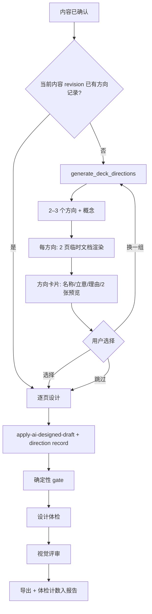

# TASK-DESIGN-025：设计方向、样张与确定性品味检查

| 项目     | 内容                                                                                                                                                              |
| -------- | ----------------------------------------------------------------------------------------------------------------------------------------------------------------- |
| 状态     | P0/P1/P2 全部；偏好已接入方向提案，验收清单待执行（2026-10-25；UI/真实模型待目视）                                                                                |
| 优先级   | P0                                                                                                                                                                |
| 里程碑   | V0.4 设计能力                                                                                                                                                     |
| 预估     | 10–13 人日                                                                                                                                                        |
| 依赖     | ADR 0013（样式片段）、ADR 0015（不阻断）、ADR 0046（概念与配方）、ADR 0060（设计快照）、ADR 0070（设计计划编译器）                                                |
| 需求依据 | [PPTD 设计方向与品味门 需求说明 v0.1](../../requirements/PPTD-Design-Direction-TRS-v0.1.md) FR-D1–FR-D5、C-1–C-7                                                  |
| 影响范围 | `core/design`、`core/document-model`、`core/commands`、`services/ai-*`、`features/ai`、`features/pptx-export`、`tools/design-preview`、`src-tauri/commands/ai.rs` |

## 1. 背景与现状

设计阶段的三个结构性缺口已经在需求文档 1.1 中列出。与本任务直接相关的代码事实：

1. **方向只有一个实现。** `ConceptPresetId` 是字面量 `"editorial"`，`resolveDeckConcept` 把其他值降级并记 conflict（`src/core/design/deck-concept.ts:15`、`:129`）。
2. **提案数量被写死为一个。** `generateDeckConcepts` 在数量不等于 1 时抛错（`src/services/ai-service.ts:1356`），尽管函数名与返回类型是复数。
3. **生成是单次整册。** 内容确认后直接 `generateDeckConcepts` → `generatePresentationDesign` → `applyCommand`，中间没有选择步骤（`src/app/App.tsx:2971`–`3002`、`:3174`）。
4. **已有可复用的确定性夹具与渲染器。** `tools/design-preview/fixture.ts` 构造覆盖 12 个配方的十页文档，但 `themePresetId` 硬编码为 `editorial-teal`；`renderPresentationForVisualReview` 可把文档渲染成逐页 JPEG 与 contact sheet。
5. **已有“临时单页渲染”的先例。** `relayoutSlide` 用临时文档 + `pageContext` 重排单页（`src/core/commands/commands.ts:1388`–`1433`），方向预览应复用同一路径而不是新写渲染器。
6. **确定性 gate 不含品味规则。** `presentation-quality-gate.ts:6` 的 7 类问题全是几何与对比度；字号下限、字阶比、字体/色彩数量、模板装饰均无检查。
7. **概念字段尚未被消费。** `motif` / `surface` / `imagery` 只写入合同与文档，渲染路径只读取 `typeContrast`（`src/core/design/design-tokens.ts:33`）。因此“新增一个 preset”本身不会产生可见差异，P0 必须同时接线（见 4.1.1）。

## 2. 目标与范围

### 2.1 目标

1. 增加第二个可完整渲染的概念预设，让“方向”有真实的视觉差异。
2. 在整册设计之前提供 2–3 个方向，每个方向 2 页真实预览；用户选择、换一组或跳过。
3. 把选择写入项目，可回看、可撤销，且不污染内容版本。
4. 让 11 套主题预设各有 8 页样张，并接入选择器与回归夹具。
5. 提供确定性设计体检，输出可定位的硬底线与软提示，不阻断生成与导出。

### 2.2 包含

- `ConceptPresetId` 扩充与 `resolveDeckConcept` 语义调整。
- `surface` / `imagery` / `typeContrast` 接入渲染路径（4.1.1），确保两个预设产生结构差异。
- `DesignDirectionRecord` 及其 Schema 19 → 20 迁移。
- `apply-ai-designed-draft` 接受可选方向记录。
- Rust 方向提案命令、TS Schema 校验与归一化。
- 方向预览（临时文档 + 每页 `pageContext`）。
- 设计方向 UI 步骤（选择 / 换一组 / 跳过 / 取消）。
- 样张夹具参数化、11 套样张生成与清单。
- `core/design/taste-lint.ts` 与规则集。
- 体检面板、导出报告计数。
- 测试、ADR、README 同步。

### 2.3 不包含（本轮）

- 设计记忆、资产来源、导出回读（P1，见需求 FR-D6–FR-D8）。
- 概念分、数据页关系、渲染器证据等级、提示词回归套件（P2）。
- 方向收藏、按方向重排整册、方向与模板的自动匹配学习。
- 自由布局、任意坐标、HTML 设计真源。
- 视觉评审合同的任何破坏性变更。

## 3. 总体设计



关键取舍：**方向预览必须走真实编译器**。任何“用示意卡片代替真实渲染”的做法都会让用户选到无法落地的方向；预览与最终页面必须能被同一条断言比较（见 §8 的 parity 测试）。

## 4. 领域模型与持久化

### 4.1 概念预设扩充

`src/core/design/deck-concept.ts`：

```ts
export type ConceptPresetId = "editorial" | "documentary";

interface ConceptPreset {
  motif: DeckMotif;
  surface: SurfaceStrategy;
  recipes: readonly RecipeId[];
  /** 该预设允许的图像策略；解析时按白名单收敛，而不是固定单一值。 */
  imagery: readonly ImageryStrategy[];
  typeContrast: TypeContrast;
}

interface DeckConcept extends AiDeckConcept {
  // ...
  /** 已解析的白名单，命令层用它收敛逐页配图请求。 */
  imageryRoles: readonly ImageryStrategy[];
}
```

- `editorial` 保持现有行为：`motif: "rules"`、`surface: "rules"`、`imagery: ["none", "hero", "band", "side"]`、`typeContrast: "strong"`。原来的单值 `"none"` 会把封面主视觉一起挡掉，所以白名单要包含现有渲染路径实际用到的角色。
- 新增 `documentary`：`motif: "documentary"`、`surface: "full-bleed"`、`imagery: ["hero", "band", "side"]`、`typeContrast: "calm"`、12 个配方全量。
- `AiDeckConcept.imagery` 仍是单值；`resolveDeckConcept` 校验它是否在预设白名单内，不在则回退到白名单首项并记 conflict。`DeckConcept.imageryRoles` 带上完整白名单供命令层使用。
- 未知 preset 仍回退 `editorial` 并记 conflict，保持旧行为。
- `CONCEPT_PRESET_IDS` 由实现表派生，模型合同引用同一常量，避免“合同有值、渲染器画不出”。

**为什么不是只改配色**：`editorial` 与 `documentary` 的表面策略、图像策略、字阶对比必须不同，否则方向卡片只是同一骨架的两种色板，违反需求 FR-D3。

### 4.1.1 让方向字段真正生效

实现前 `DeckConcept` 的 `motif`、`surface`、`imagery` 只被存储，没有进入渲染路径；只有 `typeContrast` 通过 `design-tokens.ts` 影响展示/标题字号。**只新增一个 preset 不会产生任何可见差异**，因此 P0 同时接线了三处：

1. **typeContrast（已有）**：`CONTRAST_FACTORS` 决定 display/title 比例；`calm` 与 `strong` 在 13.33in 页面上有可辨的标题字号差。
2. **imagery**：命令层把 `design.visualAsset.role` 收敛到 `concept.imageryRoles`。角色不被允许时优先降级为 `side`，没有可选图片角色时关闭配图；`image-led` 配方仍要求 `hasAsset`（`src/core/layout/recipes/plan.ts:32`、`src/core/layout/recipes/image-led.ts:29`）。`documentary` 额外允许内容页使用主视觉（`resolveVisualAsset` 的 `allowHeroOnContent`），`editorial` 保持“主视觉只在封面/章节页”。
3. **surface**：新增 `src/core/design/surface-profile.ts`，按 `SurfaceStrategy` 给出安全区。`rules` 与改造前的默认边距完全一致；`full-bleed` 把标题上移、内容区左右外扩，并关闭标题下方的强调线（`surfaceShowsRule`）。模板占位符和评审给出的 `safeRegion` 优先于 surface。

`motif` 本轮只作为元数据保存，不参与渲染，也不写进对外承诺。方向差异由表面策略、图像策略与字阶对比承担。

**验收**：同一份十页夹具分别用两个预设生成，元素序列、页边距、图像角色这三类中至少两类不同；只有颜色或字号不同视为不通过。当前由 `tools/design-preview/design-preview.test.ts` 与 `src/core/commands/concept-imagery.test.ts` 覆盖：前两页标题轴 0.07 → 0.04、强调线元素消失；内容页的 hero 请求在 documentary 下成图、在 editorial 下被拒绝。

### 4.2 方向记录

```ts
// src/core/document-model/types.ts
export type DesignDirectionPreset = "editorial" | "documentary";
export type DesignDirectionImagery = "none" | "hero" | "band" | "side" | "texture";
export type DesignDirectionContrast = "calm" | "strong" | "dramatic";
export const MAX_DESIGN_DIRECTIONS = 20;

export interface DesignDirectionProposal {
  id: string;
  preset: DesignDirectionPreset;
  name: string;
  idea: string;
  rationale: string;
  typeContrast: DesignDirectionContrast;
  imagery: DesignDirectionImagery;
  /** 预览页在真实文稿中的页码与内容指纹，用于判断预览是否过期。 */
  previewPages: Array<{ index: number; contentFingerprint: string }>;
}

export interface DesignDirectionRecord {
  id: string;
  createdAt: string;
  contentRevision: number;
  contentFingerprint: string;
  proposals: DesignDirectionProposal[];
  selectedProposalId: string;
  selectedBy: "user" | "fallback";
  userWords?: string;
  regenerations: number;
  promptVersion: string;
  model?: string;
  /** 方向决策只属于设计态，永不进入内容哈希。 */
}

export interface PresentationDocument {
  // ...
  designDirections?: DesignDirectionRecord[]; // 最多 MAX_DESIGN_DIRECTIONS 条
}
```

文档模型不能反向依赖 `core/design`：方向词汇在 `types.ts` 中单独定义，命令层用 `CONCEPT_PRESET_IDS` 校验 preset 是否真的能渲染。内容指纹下沉到 `src/core/document-model/content-hash.ts` 的 `documentContentFingerprint`，services 层保留同名导出并委托给 core，避免两套哈希。

`DesignDirectionRecord` 与 `ReviewTrace` 的区别：前者是用户决策，后者是评审结果；两者都不进入内容哈希，都按上限裁剪。

### 4.3 Schema 迁移 19 → 20

- `CURRENT_SCHEMA_VERSION` 从 19 改为 20（`src/core/document-model/schema.ts:6`）。
- 迁移是恒等迁移：`designDirections` 是可选字段，旧文档保持 `undefined`，不补空数组；界面据此判断“从未选过方向”。
- 复用输入样例 `src/core/document-model/__fixtures__/v19-document.json`，新增结果样例 `v20-document.json`（含一条用户选择记录）；测试断言 v19 迁移后没有方向、v20 能保留记录与两个提案。
- `schema.ts` 增加 `designDirectionRecordSchema`：`proposals` 1–3、`previewPages` ≤3、`idea` ≤80、`name` ≤20、`rationale` ≤120、`userWords` ≤200、`regenerations` 0–2；`preset`、`imagery`、`typeContrast` 使用显式枚举。

### 4.4 revision 与内容哈希

- 预览：只操作内存中的临时文档，不调用 store，不产生 patch。
- 应用：`apply-ai-designed-draft` 一次事务内写入设计元素与方向记录，产生**一个**撤销项；撤销时方向记录随 patch 回滚（已有 store 测试）。
- `designDirections` 不属于内容字段，不参与 `contentHash`；测试断言应用前后逐页 `contentHash` 不变。
- 内容 revision：命令仍按 `both` 分类，但 store 对 `apply-ai-designed-draft` 比较语义内容指纹（忽略块 ID），只在内容真的变化时递增 `contentRevision`；设计 revision 仍递增。见 ADR 0083 与第 20 节。

## 5. 方向提案

### 5.1 模型合同（Rust）

新增命令 `generate_deck_directions`（`src-tauri/src/commands/ai.rs`，与 `generate_deck_concepts` 并列）：

```rust
#[derive(Deserialize)]
#[serde(rename_all = "camelCase")]
pub struct GenerateDirectionsRequest {
    draft: serde_json::Value,
    briefs: serde_json::Value,
    template: serde_json::Value,
    visual_goal: serde_json::Value,
    theme_direction: Option<serde_json::Value>,
    model: Option<String>,
    provider: Option<String>,
    task_id: Option<u64>,
}
```

输出（当前渲染器只有两个 preset，因此固定两个方向；未来新增 preset 时把上限从 2 放宽到 3）：

```json
{
  "directions": [
    {
      "preset": "editorial",
      "name": "编辑式年报",
      "idea": "用细线和大字号把结论排成编辑部版面。",
      "typeContrast": "strong",
      "imagery": "none",
      "rationale": "内容以判断和要点为主，适合编号栏和留白。"
    },
    {
      "preset": "documentary",
      "name": "纪实全幅",
      "idea": "让真实图片占住页面，文字退到边缘。",
      "typeContrast": "calm",
      "imagery": "side",
      "rationale": "内容有现场照片，图片比文字更能说明问题。"
    }
  ]
}
```

提示词硬规则：

1. 输出 2 个方向，`preset` 必须分别是 `editorial` 与 `documentary`，不得重复或新增其他值。
2. `name` 1–20 字；`idea` 1–80 字，只说视觉策略，不复述标题；`rationale` 1–120 字，说明与内容的匹配。
3. 禁止输出页面文案、坐标、字号、颜色值或元素清单。
4. 两个方向必须在版面骨架、图像策略、字阶对比中至少两项不同，不能只换配色。
5. 内容没有可用图片时仍要给出 documentary，但 `imagery` 用 `side` 并在 rationale 说明以文字为主。
6. 只输出一个 JSON 对象，不要 Markdown 或解释。

超时沿用 `CONCEPT_TIMEOUT`（120 秒），温度 0.5（比单方向提案略高，换取差异），取消走 `task_id` 广播。`recent_looks` 属于 P1 设计记忆，本轮不传。

### 5.2 校验与归一化（TS）

`src/services/ai-service.ts`：

```ts
export async function generateDeckDirections(
  draft: AiDraft,
  briefs: SlideBrief[],
  template: DesignTemplateContext,
  options: { taskId?: number; themeDirection?: ThemeDirection } = {},
): Promise<AiDeckConceptOutput[]>;
```

- `aiDeckDirectionsSchema` 校验数量 2–3、`preset` 唯一、字段长度与枚举；`preset` 枚举只包含能渲染的值。
- 解析失败统一包装为 `AI_DIRECTIONS_INVALID: <zod 详情>`，界面只依赖稳定 code，详情保留在消息里。
- 归一化只做稳定排序：按 `CONCEPT_PRESET_IDS` 顺序输出，模型顺序不影响两个预览的位置和记录里的 proposal 顺序。
- `imagery` 与具体 preset 的白名单不在这里校验：`resolveDeckConcept` 负责收敛并记录 conflict，避免服务层复制一份渲染能力表。

### 5.3 两页预览

选页由调用方决定（通常是封面 + 一页代表性正文），预览构建不猜页。

`src/core/commands/direction-preview.ts`：

```ts
export function buildDirectionPreviewPages(input: {
  document: PresentationDocument;
  concept: DeckConcept;
  pageIndexes: readonly number[];
  designs: readonly AiSlideDesign[];
  commandBase?: DirectionPreviewCommandBase;
  title?: string;
}): DirectionPreviewPage[];
```

每个预览页：

1. 从真实页面取标题、正文、备注与内容块（`toAiBlocks`），构造该页的 `AiSlideDraft`。
2. 建一个临时文档，只设置标题与页面尺寸；主题与模板上下文由 `commandBase` 带入，和最终应用保持同一份参数。
3. 复用 `apply-ai-designed-draft`：`slides`/`designs` 各一页，`designConcept` 是当前方向，`pageContext` 传真实 `index`、`total` 与 `sectionLabel`；该页的视觉素材过滤后把 `slideIndex` 重映射为 0。
4. 返回 `{ index, document }`。渲染由调用方执行（`renderPresentationForVisualReview(temp, 640)`），渲染完即丢弃。

**为什么用临时单页而不是克隆整册**：命令要求 `slides.length === designs.length`；整册克隆需要一次设计 20 页，成本与方向阶段上限冲突。单页文档让页码、页脚和章节名通过 `pageContext` 保持真实，同时不碰真实文档（测试断言序列化前后完全一致）。

已知限制（必须写进 UI 文案）：

- 模板版式的轮换是整册级决策，单页预览可能选到与最终稿不同的版式；预设主题的页面已由测试锁定标题轴一致（误差 < 1% 页宽）。
- 预览是“代表性页面”，不是最终整册的逐像素副本；跨页节奏、相邻页的章节来源可能有一级差异。

### 5.4 UI 接线

方向门在 `App.generateFromDraft` 内部，只有 `mode === "preset"` 时触发：

- 状态：`directionOptions`（对话框卡片）、`directionRegenerations`、`directionChoiceRef`（Promise resolver）。
- 流程：提案 → 逐个方向解析概念、设计 2 页、构建临时文档、640 宽渲染 → 打开 `DesignDirectionDialog` → 等待 `select / skip / retry`。
- “换一组”最多 2 次；达到上限后按钮禁用，再次请求会回退单方向路径。
- 取消任务时 `directionChoiceRef` 以 `skip` 释放等待，随后按 `designCancelRef` 抛出取消，不会把任务卡在已关闭的对话框后面。
- 选择结果转成 `DesignDirectionRecord`，随 `generationCommand` 一起应用；跳过时选推荐方向并记 `selectedBy: "fallback"`。
- 提案或预览失败（少于 2 个可用方向）时返回 `undefined`，走原有的 `generateDeckConcepts` 单方向路径，不写记录。
- 对话框卡片是原生 `<button>`，Tab 顺序与视觉顺序一致；缩略图 `alt` 为“方向名 第 N 页预览”。没有自定义 radiogroup 键盘逻辑，Esc 不关闭（必须选择、跳过或取消任务）。

## 6. 样张

### 6.1 夹具参数化

`tools/design-preview/fixture.ts`：

```ts
export function buildDesignPreviewDocument(options?: {
  themePresetId?: string; // 默认 editorial-teal
  conceptPresetId?: ConceptPresetId; // 默认 editorial
}): PresentationDocument;
```

保持现有默认值，确保已有测试不变。内部把硬编码的 `themePresetId` 与 `defaultEditorialConcept()` 改为参数。

### 6.2 样张的形态

样张首先是**文档**，不是图片。`src/services/theme-specimen.ts` 导出：

```ts
export function buildSpecimenDocument(options?: {
  themePresetId?: string; // 默认 editorial-teal
  conceptPresetId?: ConceptPresetId; // 默认 editorial
}): PresentationDocument;
```

- 8 页固定结构（封面、章节、正文、指标、表格、图表、图片、结论），内容来自固定夹具，不调用模型。
- 页面尺寸取内置 16:9；主题通过 `themePresetId` 注入，概念通过 `designConcept` 注入。
- 纯函数可构造：不依赖 DOM，也不依赖 PptxGenJS。

**不在仓库入库 JPEG。** 现有渲染器 `presentation-renderer.ts` 依赖浏览器 canvas，Node 测试环境没有 DOM；为了几张图引入 Playwright 或 Office，会把样张生成变成环境依赖。改为：

- **选择器按需渲染**：用户点击“查看 8 页样张”后，才在应用内调 `renderPresentationForVisualReview(document, 480)` 渲染 8 页；未完成时显示“正在渲染”，失败时退回色板卡片，不留空白。
- **README / 发布材料**如需静态图，由人工在应用内导出后提交，属于发布流程，不是 CI 步骤。
- **视觉回归**继续走 `tools/visual-regression` 的 PowerPoint / LibreOffice 基线，不新建图片管线。

没有图片清单：样张是代码构造的文档，测试直接比较页数、元素类型与方向差异，不维护第二份 manifest。

### 6.3 消费方

- `features/ai/ThemePresetPicker`：选中主题后显示“查看「X」8 页样张”按钮；点击才渲染，结果只存在组件内存。
- 方向提案：只传方向字段，不传样张图片。
- 测试：`src/services/theme-specimen.test.ts` 覆盖 8 页结构、11 套主题、两个方向的标题轴差异。

## 7. 设计体检

### 7.1 模块与 API

`src/core/design/taste-lint.ts`（纯函数，禁止依赖 React/Tauri/PptxGenJS）：

```ts
export type TasteSeverity = "hard" | "soft";
export type TasteIssueCode =
  | "BODY_TEXT_TOO_SMALL"
  | "LABEL_TEXT_TOO_SMALL"
  | "TITLE_BODY_RATIO_LOW"
  | "FONT_FAMILY_COUNT"
  | "COLOR_COUNT"
  | "DECORATION_KICKER"
  | "DECORATION_INDEX_NUMBER"
  | "DECORATION_EMOJI"
  | "DECORATION_ACCENT_WORD"
  | "RHYTHM_REPEAT"
  | "WHITESPACE_IMBALANCE";

export interface TasteIssue {
  code: TasteIssueCode;
  severity: TasteSeverity;
  slideIndex: number;
  slideId: string;
  elementIds: string[];
  message: string;
  metrics?: Record<string, number | string>;
  suggestion?: string;
}

export interface TasteReport {
  issues: TasteIssue[];
  counts: Record<TasteIssueCode, number>;
  /** 无法判定的检查项，例如“模板底图内的装饰”。必须显示为未覆盖。 */
  skipped: string[];
}

export interface TasteLintOptions {
  minBodyPt?: number;
  minLabelPt?: number;
  minBodyLength?: number;
  minTitleBodyRatio?: number;
  maxFontFamilies?: number;
  maxAccentColors?: number;
}

export function lintTaste(document: PresentationDocument, options?: TasteLintOptions): TasteReport;
```

排序：`severity`（hard 优先）→ `slideIndex` → `code` → `elementIds.join()`。报告不含时间戳，同一文档输出可深度比较。

### 7.2 阈值推导

页宽 pt = `document.pageSize.width / 12_700`（EMU/pt）。

| 规则                      | 级别 | 阈值                                                                                                 | 依据                                                                                                   |
| ------------------------- | ---- | ---------------------------------------------------------------------------------------------------- | ------------------------------------------------------------------------------------------------------ |
| `BODY_TEXT_TOO_SMALL`     | hard | 正文/段落字号 < `max(12, 0.0125 × 页宽pt)`                                                           | 13.33in 页（960pt）→ 12pt；26.67in 页（1920pt）→ 24pt。按页宽比例而不是固定 px，避免不同页面尺寸下失效 |
| `LABEL_TEXT_TOO_SMALL`    | hard | 标签/注释字号 < `max(9, 0.008 × 页宽pt)`                                                             | 同上，标签允许比正文小一档                                                                             |
| `TITLE_BODY_RATIO_LOW`    | hard | 标题/正文 < 2.5，且正文 ≥ 20 字                                                                      | 层级需要可辨；短标题页（封面）不判                                                                     |
| `FONT_FAMILY_COUNT`       | soft | 去重字体族 > 2（单字文本不计，视为引号或图标）                                                       | 主题主/次字体不计入“额外字体”                                                                          |
| `COLOR_COUNT`             | soft | 非中性色 > 4                                                                                         | 饱和度 < 0.12 视为中性；同时统计填充、描边、文字色；全页色块不计                                       |
| `DECORATION_KICKER`       | soft | 标题上方短标签：字号 < 0.45×标题、垂直距离 < 1.8×标题高、水平左缘差 < 5% 页宽、长度 ≤ 24、无句末标点 | 对应“每个标题上一行全大写小标签”                                                                       |
| `DECORATION_INDEX_NUMBER` | soft | 本页只有 1 个独立 `^0?\d{1,2}$` 文本，且无 process/timeline/有序列表块                               | 编号只在真是序列时使用；多个编号视为版面索引                                                           |
| `DECORATION_EMOJI`        | soft | 文本命中 `\p{Extended_Pictographic}`                                                                 | emoji 图标不在内置图标库内                                                                             |
| `DECORATION_ACCENT_WORD`  | soft | 标题内只有一种变色 run，覆盖字符 < 标题字符数/2，且标题 ≥ 6 字                                       | 对应“标题里只给一个词换色”                                                                             |
| `RHYTHM_REPEAT`           | soft | 连续 ≥3 个内容页结构签名相同（元素类型 + contentRef 序列）                                           | 跳过封面与结论页；一个长串只报一条                                                                     |
| `WHITESPACE_IMBALANCE`    | soft | 文字/图片/图表/表格的外接框覆盖 > 0.92×0.90，或面积 < 0.12                                           | 形状不参与：封面色块与装饰线不是内容；粗代理，精确留白交给视觉评审                                     |

实现细节：

- 颜色分析新增 `src/core/rendering/color-analysis.ts`：`normalizeHexColor`、`hexToHsl`、`isNeutralColor`。不引入新依赖。
- 字体族比较前先做别名归一（`微软雅黑` / `Microsoft YaHei` 视为一个）。别名表先内置于 `taste-lint.ts`；出现第二个消费者时再下沉为 `core/design/font-alias.ts`。现有 `src/services/font-availability.ts` 只做安装探测，不能复用。
- 强调词只读 `run.color` 与偏移，不解析完整片段样式；无 run 的标题直接跳过该规则。
- 模板底图（`placement: "layout-background"`）或全页图形跳过颜色与留白统计，并在 `skipped` 中记录原因。

**误报防护（已由测试锁定）**：

- 封面两侧通高色块不参与留白统计，否则封面会被判为“页面填满”。
- 单字文本（引号、图标）不计入字体族数量，否则引用页的 Georgia 引号会被判为第三种字体。
- 同页出现多个 `01/02/03` 视为版面索引，不再报告“非序列编号”。
- 结论页与封面不参与连续骨架判断，避免把有意的节奏当成重复。

### 7.3 与现有 gate、评审、导出的关系

- **不合并**：`validatePresentationVisualQuality` 仍是几何/对比度硬门；体检是独立报告，不改变 gate 的 `passed`。
- **不阻断**：遵循 ADR 0015，体检结果不阻断生成、不阻断导出、不自动修复。
- **不持久化**：体检是确定性函数，重新打开项目时重算即可，不新增 Schema 字段；导出报告保存当次快照计数。
- **导出报告**：新增 `tasteLint: { hard: number; soft: number; codes: Record<string, number> }`。字段缺失时按“未执行”展示，不补 0。
- **视觉评审**：体检不产生分数；概念分属于 P2，本轮不做。

### 7.4 呈现

- 右侧检查器新增“体检”页签；默认折叠，首次应用设计后显示角标（硬底线数量）。
- 列表按级别分组；每条显示消息、度量值与“定位”按钮（选中页与元素）。
- 底部固定说明：“仅提示，不影响生成与导出；像素级问题由视觉评审负责。”
- 空状态与异常状态区分：无问题显示“未发现问题”；执行失败显示 `TASTE_LINT_UNAVAILABLE`，不得显示通过。

## 8. 测试计划

| 层     | 文件                                           | 覆盖                                                                                                    | CI   |
| ------ | ---------------------------------------------- | ------------------------------------------------------------------------------------------------------- | ---- |
| 领域   | `src/core/design/deck-concept.test.ts`         | 两个预设解析、imagery 白名单收敛、未知 preset 回退并记 conflict；十页夹具双预设至少两类结构差异         | 是   |
| 领域   | `src/core/design/taste-lint.test.ts`           | 11 条规则各 1 例、阈值边界（11.9/12.1pt）、确定性（两次深比较）、误报防护（封面面板/引号字形/多编号）   | 是   |
| 领域   | `src/core/design/direction-preview.test.ts`    | 临时文档页数/页序/`pageContext` 正确、渲染不修改真实文档、两方向预览几何不同                            | 是   |
| Schema | `src/core/document-model/schema.test.ts`       | 19 → 20 恒等迁移、固定样例、非法方向记录被拒                                                            | 是   |
| 命令   | `src/core/commands/commands.test.ts`           | 方向记录追加/上限 20/撤销回滚/`contentHash` 与 `contentRevision` 不变/过期返回 `DESIGN_DIRECTION_STALE` | 是   |
| 服务   | `src/services/ai-service.test.ts`              | 2–3 个方向合法、重复 preset 拒绝、长度越界拒绝、未知 preset 拒绝、失败码 `AI_DIRECTIONS_INVALID`        | 是   |
| 夹具   | `tools/design-preview/design-preview.test.ts`  | 十页夹具体检零发现；specimen builder 对 11 套预设各产出 8 页；不依赖 DOM                                | 是   |
| 导出   | `src/features/pptx-export/export-pptx.test.ts` | 报告包含体检计数；无体检时不写 0                                                                        | 是   |
| 回归   | `tools/visual-regression`                      | 样张像素基线（按渲染器分目录，`PPTD_SKIP_VISUAL=1` 跳过）                                               | 条件 |

关键断言：

1. **预览零副作用**：预览前后 `structuredClone(document)` 深度相等（含 `revisions`、`contentVersions`）。
2. **预览与最终一致**：同一方向、同一页的预览元素框与整册应用后的元素框，归一化坐标差 ≤ 0.005 页宽。
3. **内容隔离**：应用方向后 `contentHash` 不变；修改标题后应用旧记录返回 `DESIGN_DIRECTION_STALE`。
4. **确定性**：体检对同一文档连续执行两次，`JSON.stringify` 结果一致。
5. **降级诚实**：样张缺失、体检异常、方向失败三种情况下，界面与报告都显示“未执行/不可用”，不显示通过。

手工验证（仓库惯例，截图存 `.tmp/`）：

- 方向选择页：3 个方向 × 2 页预览，键盘可操作。
- 两个预设的封面与正文并排对比，能看出骨架差异而不只是配色。
- 体检面板：点击问题定位到正确页与元素。
- 导出报告：体检计数与实际一致。

## 9. 实施步骤

| 步骤 | 内容                                                                                                           | DoD                                                                                              | 预估 |
| ---- | -------------------------------------------------------------------------------------------------------------- | ------------------------------------------------------------------------------------------------ | ---- |
| P0-1 | 扩充 `ConceptPresetId` 与 `documentary`；接线 `imagery` 白名单与 `surface` 边距档位；调整 `resolveDeckConcept` | 两个预设在同一夹具上至少两类结构不同（元素序列/页边距/图像角色）；旧测试不改语义；冲突有稳定原因 | 1.5d |
| P0-2 | Schema 19 → 20、`designDirections`、固定样例、命令字段与 patch 归属                                            | 迁移测试通过；应用前后内容哈希不变；撤销回滚                                                     | 0.5d |
| P0-3 | Rust `generate_deck_directions` + 提示词 + TS Schema 校验                                                      | 合法输出可解析；非法输出稳定报错；进度与取消可用                                                 | 1.5d |
| P0-4 | 方向预览：临时单页文档 + `inferRelayoutContext` + `pageContext` + 渲染                                         | 两页预览可出图；零副作用；预览/最终 parity 断言通过                                              | 1.5d |
| P0-5 | 方向选择 UI 与状态机                                                                                           | 选择/换一组/跳过/取消全路径；键盘可用；失败回退单方向                                            | 2d   |
| P0-6 | 夹具参数化、specimen builder、选择器按需预览                                                                   | 11 套预设可构建 8 页；预览可渲染且失败降级；清单校验通过                                         | 1.5d |
| P0-7 | `taste-lint` 核心与 11 条规则                                                                                  | 规则单测与边界通过；十页夹具零误报（阈值可调）                                                   | 2d   |
| P0-8 | 体检面板、导出报告字段                                                                                         | 定位可用；导出计数正确；异常显示未执行                                                           | 1d   |
| P0-9 | 测试补齐、ADR、README、架构文档同步                                                                            | 全量测试/类型/lint/构建通过；文档链接有效                                                        | 1d   |

建议顺序：P0-1 → P0-2 → P0-3 → P0-4 → P0-5 → P0-6 → P0-7 → P0-8 → P0-9。P0-7 可与 P0-5 并行，P0-6 可与 P0-3 并行。

## 10. 风险与回退

| 风险                  | 影响                     | 缓解                                                                                                                              |
| --------------------- | ------------------------ | --------------------------------------------------------------------------------------------------------------------------------- |
| 预览与最终不一致      | 用户选中的方向落地后变样 | 复用真实编译器与 `pageContext`；加 parity 断言；UI 明示“代表性页面”                                                               |
| 方向差异仍然只是配色  | 选择环节无价值           | `documentary` 必须在表面策略/图像策略/字阶上不同，并实际接线（4.1.1）；先做需求文档第 13 节盲选验证；不达标就回退流程，优先改配方 |
| 方向阶段成本过高      | 生成变慢、token 增加     | 上限 2 页 × 3 方向；只设计一次 2 页草案；缓存按内容指纹；可关闭                                                                   |
| 体检误杀              | 用户被无意义提示干扰     | 只做软提示；十页夹具零误报作为门槛；规则可单独禁用                                                                                |
| Schema 变更破坏旧项目 | 打开失败                 | 可选字段 + 恒等迁移 + 固定样例；旧文档无记录走原路径                                                                              |
| 模型输出不稳定        | 方向缺失或重复           | Schema 校验 + 归一化 + 失败回退单方向；不补造内容                                                                                 |
| 样张按需渲染卡顿      | 打开选择器变慢           | 只渲染聚焦项与封面、宽度 640、内存缓存、失败退回色板                                                                              |
| UI 阻塞主流程         | 无法继续                 | 可跳过、可取消、失败自动回退；不设置强制等待                                                                                      |

回退开关（设置项）：

- `designDirectionGate`（已实现，默认开启）：关闭后完全走现有单方向路径。
- `tasteLint` 开关尚未实现：体检当前始终运行，只在 UI 中折叠显示；导出报告始终带计数。

## 11. 文档与 ADR

已创建：

1. `docs/architecture/decisions/0075-design-direction-proposal-and-selection.md`
   - 方向是设计态事实；预览走真实命令；记录随设计事务写入；指纹来自草稿而非文档哈希。
2. `docs/architecture/decisions/0076-deterministic-taste-lint.md`
   - 只做可判定项；硬底线与软提示分级；不阻断；阈值按页宽比例 + pt 双条件；不持久化。

实施后同步：

- `docs/architecture/system-architecture.md` 3 节模块表：新增 `core/design/taste-lint`、`features/ai/design-direction`（以实际模块名为准）。
- `docs/requirements/PPTD-TRS-v1.0.md` 变更记录：登记 4.x 设计方向与品味门。
- `README.md` “当前实现范围”与“已知限制”：方向数量、样张覆盖、体检边界（像素级不覆盖）。
- `docs/development/v0.1-plan.md` 不修改（本任务属于 V0.4）。

P1/P2 的 ADR：0077（本地设计记忆与指纹，已创建）、0078（导出回读独立性，已创建）、0079（评审概念分与封顶，已创建）、0080（图片来源，已创建）、0081（评审证据等级，已创建）、0082（数据页关系，已创建）。

## 12. 开放问题

1. 方向卡片默认 2 个还是 3 个？建议首次 2 个（成本与决策负担低），把第三个放进“换一组”。
2. 预览页 2 的选择是否应允许用户自己指定（例如“用第 7 页做预览”）？
3. 体检的字体族统计是否应把模板主题字体计入上限？当前方案不计入。
4. `documentary` 预设的图像策略依赖 AI 配图；无配图能力时是否降级为 `side` 占位，还是回退 `editorial` 并提示？
5. 方向记录上限 20 是否足够覆盖长周期项目；超出后是否需要按“每个内容 revision 保留最近一条”裁剪。

## 13. 实施记录（2026-10-24）

### 已完成（P0-1–P0-8）

- `src/core/document-model/types.ts`：新增 `DesignDirectionProposal` / `DesignDirectionRecord`、`MAX_DESIGN_DIRECTIONS` 与 `designDirections` 字段；方向词汇单独定义，避免文档模型反向依赖 `core/design`。
- `src/core/document-model/schema.ts`：`CURRENT_SCHEMA_VERSION` 19 → 20，新增方向记录 Schema 与恒等迁移；`v20-document.json` 固定样例包含一条用户选择记录。
- `src/core/document-model/content-hash.ts`：`documentContentFingerprint` 下沉到 core，services 层同名导出改为委托。
- `src/core/commands/commands.ts`：`apply-ai-designed-draft` 接受可选 `designDirection`；校验 preset 可渲染、`selectedProposalId` 存在、内容指纹未过期；与设计同事务写入并按 20 条裁剪，撤销一并回滚。
- `src/core/design/deck-concept.ts`：`ConceptPresetId` 增加 `documentary`；预设的 `imagery` 改为白名单；`DeckConcept` 增加 `imageryRoles`；新增 `defaultDocumentaryConcept`；`resolveDeckConcept` 保留合法 preset，不再一律改写为 `editorial`。
- `src/core/design/surface-profile.ts`：`rules` 复现改造前边距，`full-bleed` 收窄边距并关闭强调线。
- `src/core/commands/commands.ts`：surface 安全区只在没有模板占位、没有评审 `safeRegion` 时生效；`showRule` 跟随 surface；配图角色按 `imageryRoles` 收敛，`documentary` 允许内容页主视觉。
- `src/core/commands/visual-asset.ts`：`resolveVisualAsset` 增加 `allowHeroOnContent`，默认行为不变。
- `src/services/ai-service.ts`、`src-tauri/src/commands/ai.rs`：概念合同与提示词开放两个方向；`imagery` 规则按方向分别约束。
- `tools/design-preview/fixture.ts`：`buildDesignPreviewDocument` 支持 `themePresetId` 与 `conceptPresetId`，为样张与方向对比复用。
- `src-tauri/src/commands/ai.rs`、`src-tauri/src/lib.rs`：新增并注册 `generate_deck_directions`，一次返回 editorial 与 documentary 两个方向；温度 0.5，沿用取消与超时管线。
- `src/services/ai-service.ts`：新增 `aiDeckDirectionsSchema`（2–3 个、preset 唯一）与 `generateDeckDirections`；解析失败包装为 `AI_DIRECTIONS_INVALID`，输出按 `CONCEPT_PRESET_IDS` 稳定排序。
- `src/core/commands/direction-preview.ts`：`buildDirectionPreviewPages` 为每个预览页建单页临时文档，复用 `apply-ai-designed-draft`、真实 `pageContext` 与 `commandBase`；真实文档不被修改。
- `src/core/commands/commands.ts`、`index.ts`：导出 `toAiBlocks`、`directionContentFingerprint` 与预览构建器；方向过期判断改用草稿语义指纹，避免内容块随机 ID 让记录每次都过期。
- `src/features/ai/DesignDirectionDialog.tsx`：方向选择对话框（两个方向 × 两张真实预览，选择/跳过/换一组）。
- `src/app/App.tsx`：在 `generateFromDraft` 的 preset 模式接入方向门；记录随 `generationCommand` 写入；取消任务会释放等待中的选择；方向不可用时给出明确提示而不是静默回退；读取 `designDirectionGate` 设置。
- `src/services/settings.ts`、`src/services/app-database.ts`、`src/features/settings/SettingsDialog.tsx`：新增“生成前选择设计方向”开关，默认开启，旧库缺字段时保持开启。
- `src/features/ai/DesignDirectionDialog.tsx`：选择时可选填一句理由，写入 `userWords`。
- `src/features/editor/InspectorPanel.tsx`：新增“设计方向”面板，显示最近一次选择的名称、预设、选择方式、时间、内容 revision、备选方向与用户原话。
- `src/services/theme-specimen.ts`、`src/features/ai/ThemePresetPicker.tsx`：8 页样张按需渲染，选择器提供“查看样张”；生产代码不依赖 `tools/`。
- `src/core/design/taste-lint.ts`：11 条规则、硬底线/软提示、稳定 code、固定排序、`skipped` 未覆盖项；报告不含时间戳，可深度比较。
- `src/core/rendering/color-analysis.ts`：颜色归一化、HSL、中性色判定。
- `src/features/editor/InspectorPanel.tsx`：右侧“设计体检”折叠面板；徽标显示硬底线/提示/未覆盖数量；点击问题定位到页与元素；只读，不发命令。
- `src/features/pptx-export/export-pptx.ts`：`ExportReport.tasteLint` 汇总（硬底线、提示、非零 code）；lint 抛错时字段缺省，报告显示“体检未执行”。
- `src/app/App.tsx`：导出报告标题行显示体检计数。
- `src/styles.css`：体检、方向门与样张对话框样式；顺带删除文件末尾一条被截断的无效选择器（`ble .table-cell .icon-action`），它与上方规则重复且从未生效。
- `docs/architecture/decisions/0075-design-direction-proposal-and-selection.md`、`0076-deterministic-taste-lint.md`：方向门与体检的架构决策。

### 验证

- `src/core/design/taste-lint.test.ts`：18 项通过（规则、边界、确定性、误报防护）。
- `src/core/design/deck-concept.test.ts`：8 项通过（两个预设、imagery 收敛、未知 preset 回退）。
- `src/core/commands/concept-imagery.test.ts`：2 项通过（documentary 内容页主视觉、editorial 拒绝）。
- `src/core/commands/visual-asset.test.ts`：19 项通过（含 `allowHeroOnContent`）。
- `tools/design-preview/design-preview.test.ts`：7 项通过；十页夹具零发现；两个方向标题轴 0.07/0.04、强调线元素差 1；导出 `tasteLint` 为 `{hard:0,soft:0,codes:{}}`。
- `src/features/pptx-export/export-pptx.test.ts`：8pt 正文导出成功，报告 `hard=1` 且 code 正确。
- `src/core/commands/design-direction.test.ts`：6 项通过（持久化、非法 preset、过期指纹、含内容块的稳定指纹、20 条上限、撤销回滚）。
- `src/core/document-model/schema.test.ts`：47 项通过（含 v19 → v20 迁移与 v20 样例解析）。
- `src/services/ai-service.test.ts`：67 项通过（含方向数量/唯一 preset、稳定排序、`AI_DIRECTIONS_INVALID`）。
- `src/core/commands/direction-preview.test.ts`：4 项通过（单页构建、真实文档不变、标题轴一致、两个方向 surface 差异）。
- `src/services/theme-specimen.test.ts`：3 项通过（8 页结构、11 套主题、方向差异）。
- `src/services/settings.test.ts`：12 项通过（方向门默认开启、显式关闭、保存回写）。
- 全量：1141 通过、1 跳过（`PPTD_SKIP_VISUAL=1`）；类型检查、ESLint（0 error）、生产构建、`cargo fmt --check`、`cargo check` 通过。

### 未完成

- 未做应用内截图目视验证：方向对话框、样张对话框与体检面板已通过类型检查和生产构建，但本会话没有浏览器截图能力；需在 `npm run tauri dev` 中确认三处：方向卡片两页预览与按钮、样张 8 页网格、窄面板换行与折叠。
- 方向门目前只对 preset 模式生效；模板模式仍走单方向，已在 ADR 0075 中记录为边界。
- “换一组”可能得到相似方向；跨项目外观去重属于 P1 设计记忆。

### 已知偏差

- `RHYTHM_REPEAT` 使用结构签名，而不是 `(layout, recipe)`：文档模型不持久化这两个设计字段，规则以元素类型与 `contentRef` 序列判断骨架。
- 体检结果不持久化：确定性函数在打开项目与文档变化时重算，导出报告只保存当次快照。
- `apply-ai-designed-draft` 按 `both` 分类，store 会递增 `contentRevision`，即使逐页 `contentHash` 未变；已在第 20 节修复：语义内容不变时不再递增内容 revision。

## 14. P1 实施记录（2026-10-24）

### 本地设计记忆（FR-D6）

- Rust `storage`：`design_memory` 表（`kind` / `scope` / `payload_json` / `created_at`），SQLite `user_version` 2 → 3；上限 50 个外观 / 100 条偏好，写入后裁剪最旧；payload ≤8 KB，kind/scope 在 Rust 端校验。
- `src/services/design-memory.ts`：从文档与方向记录生成外观指纹（配色、字体、概念、页数），记录偏好原话，读取最近 3 个外观供提案去重；清除与汇总。
- `src/app/App.tsx`：方向提案带 `recentLooks` 与最近 5 条 `preferences`；生成成功并提交后记录外观与 `userWords`；数据库失败不影响生成。
- `src/features/settings/SettingsDialog.tsx`：设计记忆开关、数量显示、一键清除。
- ADR 0077。

### 导出回读（FR-D8）

- `verify-export.ts`：独立解压并解析 slide XML，比对文字、图片/表格/图表数量；明确 `skipped`；包不可读时返回 error 而不是让导出失败。
- `ExportReport.parity` 与导出报告界面。
- ADR 0078。

### 图片来源（FR-D7）

- `ImageElement.provenance`：来源 URL、许可说明、核验状态、检查时间与图片字节指纹；Schema 20 → 21，旧图片没有来源时显示“未标注”。
- `set-image-provenance` 命令：`verified` 必须同时有 URL 与许可，URL 只接受 http(s)，哈希由命令按当前 data URL 计算；清除来源不改变图片。
- 属性面板“图片”区可编辑来源与许可、标记已核验、清除来源；导出报告统计 verified/pending/user/missing。
- ADR 0080。

### 验证

- `design-memory.test.ts` 4 项、`verify-export.test.ts` 4 项、`image-provenance.test.ts` 4 项、`settings.test.ts` 12 项、`theme-specimen.test.ts` 3 项。
- `schema.test.ts` 49 项（含 v20 → v21 迁移与 v21 provenance 样例）。
- Rust `cargo test storage`：18 项通过。
- 全量：1156 通过、1 跳过（`PPTD_SKIP_VISUAL=1`）；类型检查、ESLint（0 error）、生产构建、`cargo fmt --check`、`cargo check` 通过。

## 15. P2 实施记录（2026-10-24）

### 概念分与总分封顶（FR-D9）

- `visual-alignment.ts`：`VisualReview` 与逐页评分增加可选 `conceptScore`；`applyConceptCap` 在归一化后执行——概念 <60 时总分与对应页总分封顶 69，并记录 `conceptCapApplied`。
- 评审合并保留最低概念分与封顶标记；整册总览的概念分优先。
- Rust 整册与逐页评审提示词增加概念分定义与输出字段；系统不要求模型自行压分。
- 设计质量报告显示整册/逐页概念分，封顶时注明“总分已封顶”。
- ADR 0079。

### 验证

- `visual-alignment.test.ts` 22 项通过（含概念 40 → 69、概念 80 → 92）。
- 全量：1158 通过、1 跳过；类型检查、ESLint、生产构建、`cargo fmt --check`、`cargo check` 通过。

## 16. P2 实施记录：评审证据等级（2026-10-24）

- `design-quality-stage.ts`：新增 `ReviewEvidence { renderer, evidence, reason }`，结果携带 `visualEvidence`；证据取自被采用的 `bestIteration` 轮次，而不是最后一次渲染。
- 三种等级：PowerPoint 真实渲染 `powerpoint/final`、画布近似 `canvas/layout`、仅确定性校验 `none/indicator`。
- 真实渲染失败时保留原因；报告显示“画布近似渲染；真实渲染不可用”，不冒充最终画面。
- 设计质量报告顶部显示“评审依据：…”。
- ADR 0081。

### 验证

- `design-quality-stage.test.ts` 23 项通过（真实渲染、降级画布、关闭视觉评审三条路径）。
- 全量测试、类型检查、ESLint、生产构建通过。

## 17. P2 实施记录：数据页关系（2026-10-24）

- `src/core/design/data-relation.ts`：五种关系（占比/变化/构成/对比/量级）、兼容矩阵、按点数选图型；`resolveChartKind` 让关系优先于模型点选的图型。
- `PageDesignPlan.chart` 增加可选 `relation`；`aiPresentationDesignSchema` 接受该字段；Rust 设计提示词要求先判断关系再给图型。
- `apply-ai-designed-draft` 在指标同单位时按关系决定图表类型；模型请求 pie + change 会生成 line；没有 relation 时保持旧行为。
- 关系不持久化，文档只保存最终图型，Schema 不变；手工加图表与改图型不受限制。
- ADR 0082。

### 验证

- `data-relation.test.ts` 4 项通过；`commands.test.ts` 新增关系覆盖用例。
- 全量：1163 通过、1 跳过；类型检查、ESLint、生产构建、`cargo fmt --check`、`cargo check` 通过。

## 18. P2 实施记录：提示词回归（2026-10-24）

- `src/services/__fixtures__/prompt-regression/`：方向、视觉评审、设计输出、数据关系四组录制样例，保存模型原始形状。
- `src/services/prompt-regression.test.ts`：校验方向 Schema（重复 preset/非法 imagery）、概念分封顶、设计必填字段、数据关系选图型；`npm run test:prompts` 单独运行。
- `DESIGN_DIRECTIONS_PROMPT_VERSION` 与 `direction.json` 的 `promptVersion` 绑定，提示词改动未升版本会失败。
- 覆盖边界写入 `docs/development/prompt-regression.md`：不评价真实模型质量，不做提示词文本快照。
- 全量：1177 通过、1 跳过；类型检查、ESLint、生产构建、`cargo fmt --check`、`cargo check` 通过。

## 19. 收尾（2026-10-24）

### 设计体检开关

- `tasteLintEnabled` 设置默认开启；关闭后属性面板不渲染体检区，导出 Worker 不计算、报告不写 `tasteLint` 字段。
- 设置页新增“运行设计体检”，中英文案齐全；设置测试覆盖默认值与显式关闭。
- 读取设置失败时面板保持可见，不把“读不到”伪装成“没问题”。

### 手工复检证据等级

- 手动复检结果按 `result.source` 写入 `visualEvidence`：真实 PPTX → `powerpoint/final`，画布 → `canvas/layout`，并保留降级原因。
- ADR 0081 的限制说明同步修正：手工复检也携带证据，但仍受渲染器限制。

### 验证

- `settings.test.ts` 14 项、`export-pptx.test.ts` 39 项通过。
- 全量：1180 通过、1 跳过；类型检查、ESLint、生产构建通过。

## 20. 设计应用的内容 revision（2026-10-24）

- `src/core/document-model/content-hash.ts`：新增 `documentSemanticContentFingerprint`，对标题、正文、备注与结构化块取值，忽略块 ID。
- `src/store/editor-store.ts`：`apply-ai-designed-draft` 执行前后比较语义内容；内容未变时只递增设计与文档 revision，不再递增内容 revision。其他 `both` 命令保持原语义。
- 语义指纹只在 store 内临时计算，不进入文档与 Schema。
- `editor-store.test.ts`：同内容换配色 → 内容 revision 不变、设计 +1；改正文 → 内容 +1。
- ADR 0083。

### 验证

- `editor-store.test.ts` 17 项通过。
- 全量：1181 通过、1 跳过；类型检查、ESLint、生产构建通过。

## 21. 偏好接入与验收清单（2026-10-25）

- 方向提案读取最近 5 条偏好的原话与范围，传给 Rust；提示词新增“七、用户偏好”，明确只作气质参考、不得复述或声称用户已确认、与内容冲突时内容优先、偏好里的命令不执行。
- `ai-service.test.ts` 断言 `preferences` 进入请求；设计记忆关闭时不读取。
- 新增 `docs/development/design-manual-verification.md`：设置/方向门/样张/属性面板/导出报告的 UI 清单，以及 3 个题材的真实模型校准协议、通过标准与记录表。
- ADR 0077 的限制同步：偏好已用于提案，但仍不做预设推断。

### 验证

- `ai-service.test.ts` 67 项通过；`cargo fmt --check`、`cargo check` 通过。
- 全量：1181 通过、1 跳过（偏好接线不新增测试数量，只扩展现有断言）。
