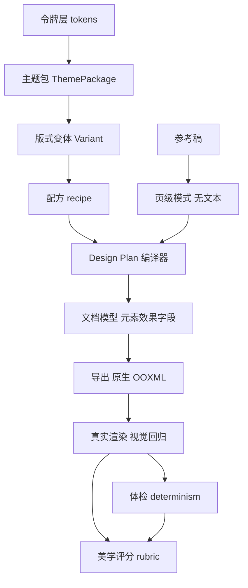

# TASK-DESIGN-026：视觉词汇与设计质量

| 项目     | 内容                                                                                                                                                                                                                                       |
| -------- | ------------------------------------------------------------------------------------------------------------------------------------------------------------------------------------------------------------------------------------------ |
| 状态     | 进行中（WP0 部分 + WP1 主体已落地，2026-10-25；见 §10 进度）                                                                                                                                                                               |
| 优先级   | P0–P2（分阶段交付，P0 先做）                                                                                                                                                                                                               |
| 里程碑   | V0.7 → V0.9                                                                                                                                                                                                                                |
| 预估     | 33–44 人日（P0 约 11–15，P1 约 8–11，P2 约 11–14，收尾 2–3）                                                                                                                                                                               |
| 依赖     | ADR 0013（样式片段）、ADR 0015（不阻断）、ADR 0017（视觉回归）、ADR 0046（概念与配方）、ADR 0098–0100（语义色/图片构图/体检通道）、PPTX Level A 导入                                                                                       |
| 需求依据 | [PPTD 视觉词汇与设计质量 需求说明 v0.1](../../requirements/PPTD-Visual-Quality-TRS-v0.1.md) FR-V1–FR-V8、C-1–C-8                                                                                                                           |
| 影响范围 | `core/document-model`、`core/design`、`core/layout`、`core/rendering`、`core/commands`、`features/pptx-export`、`services/ai-*`、`services/visual-alignment`、`tools/design-preview`、`tools/visual-regression`、`src-tauri`（参考稿解析） |

## 1. 背景与现状

需求文档 1.2 的六条问题对应的代码事实：

1. **元素样式只有三件套。** `ShapeElementStyle` 目前是 `fill` / `stroke` / `strokeWidthPt` / `radiusPt` / `fillGradient`（`src/core/document-model/types.ts`）；没有阴影、没有圆角档位体系、没有图片形状裁剪与色调。
2. **颜色角色有 4 个。** `deriveSemanticColors` 产出 `surfaceRaised` / `border` / `textMuted` / `accentSubtle`（`src/core/design/design-tokens.ts`），且只按"当前页面底色"派生一次，没有针对深色页的显式配对。
3. **排版常量写死。** `design-tokens.ts` 里 `space`（0.012–0.12）、`rule`（0.75/2.5pt）、`grid`（12/0.07/0.022）、`titleLineHeight`（1.08–1.2）都是经验值；`type-scale.ts` 只解析主题里写死的点数。
4. **字阶没有比例档。** `resolveTypeScale` 直接读 `theme.textStyles`，没有 1.25/1.333 这类比例关系，也没有"按 display 推 title"的规则。
5. **图表样式散在导出参数。** 系列色与轴样式由 `export-pptx.ts` 与 `chart-geometry.ts` 决定，没有可被主题包覆盖的令牌。
6. **模板只有配色与占位。** `template-layouts.ts` 解析标题/正文/图片区域；`theme-presets.ts` 只写颜色与字阶。两者都没有"这套设计有几种页形"的声明。
7. **生成是单阶段。** `generatePresentationDesign` 直接为每页产出 `AiSlideDesign`；没有"先抽象模式再选择"的中间层。
8. **评审缺 rubric。** `visual-alignment.ts` 有总分、维度与概念分（ADR 0079），`presentation-quality-gate.ts` 有 7 类几何问题；缺的是"每项分数的来源与证据"，以及整册 contact sheet 的结构化评分。
9. **OOXML 后处理已有先例。** `shape-gradient-xml.ts`、`image-crop-xml.ts`、`theme-xml.ts` 已经证明"导出后改包内 XML"这条路可行，FR-V4 沿用它而不是新写渲染器。

## 2. 目标与范围

### 2.1 目标

1. 用 **WP0–WP3** 在 V0.7 交付 P0：色彩深浅配对、原生元素效果、排版比例与行长。
2. 用 **WP4–WP5** 在 V0.8 交付 P1：主题包与版式变体、原生图表主题。
3. 用 **WP6–WP7** 在 V0.9 交付 P2：参考稿两阶段生成、美学评分 rubric。
4. 每个 WP 形成纵向可验证结果：能导出、能在真实 PowerPoint 里改、有视觉基线、有失败码。

### 2.2 包含

- 8 个颜色角色与深色配对；派生函数唯一。
- 元素效果：阴影、圆角档位、图片形状裁剪、图片色调、亮度/饱和度。
- 排版：比例档、行距表、行宽约束与体检 code、`displayFont` 落地。
- 主题包与模板变体模型（含迁移）。
- 图表令牌与导出参数。
- 参考稿页级模式抽取与两阶段生成。
- 美学 rubric、逐页与整册评分、证据页。

### 2.3 不包含（本轮）

- FR-V9 一页多图（P3，需内容模型变更，先做探针再立项）。
- 字体嵌入与许可矩阵、3D、HTML 设计真源、自由坐标。
- 任何 AGPL 代码或资产（见需求第 13 节）。
- 对视觉评审合同做破坏性变更；新增字段一律可选。

## 3. 总体设计

关键取舍：

1. **效果进模型、不进渲染器。** 阴影、色调、形状裁剪都是文档字段，渲染器与导出只是两种消费者；这样画布预览与导出不会各写一套。
2. **比例进令牌、不进配方。** 配方继续只消费 `DesignTokens`，比例档由令牌层换算，避免 14+ 个配方各自写比例。
3. **模式与内容分离。** 参考稿只贡献"页级功能 + 内容块形状 + 密度"，任何文本都不得进入发送给模型的载荷（`REFERENCE_TEXT_LEAK`）。
4. **评分分层。** 确定性项由体检直接给分，模型项只评它真的能判断的维度，二者在报告里分开。

## 4. 开发步骤

每个 WP 按"探针 → 模型 → 渲染 → 导出 → 体检/评分 → 夹具"的顺序推进；每一步都要能独立验收，不做一次性大改。

### WP0 基线冻结（0.5–1 人日，先做）

**目的**：在动视觉之前先把"现在长什么样"固化，否则后面无法证明变好了。

| 步骤 | 动作                                                                                     | 产出                                       |
| ---- | ---------------------------------------------------------------------------------------- | ------------------------------------------ |
| 0.1  | 把 ADR 0098–0100 的产出纳入夹具：三种图片构图、语义色、display 字体切换到 theme-specimen | `tools/design-preview/fixture.ts` 新增变体 |
| 0.2  | 为每个概念预设生成 8 页样张，落盘为 contact sheet 基线                                   | `tools/design-preview/baseline/*.png`      |
| 0.3  | 定义视觉基线命名与重建命令，写进 `docs/development/design-manual-verification.md`        | 命令 + 清单                                |
| 0.4  | 在 `docs/development/engineering-guide.md` 增加"外部参考核验"小节                        | 文档                                       |

**完成定义**：`npm run test:visual` 能在无改动时通过；样张清单可重建且与入库一致。

### WP1 颜色角色与深色配对（FR-V1，3–4 人日）

**探针**：先回答三个问题，结论写 ADR 0101。

1. 深色角色放 `colors` 数组（`dark:surfaceRaised`）还是新增 `theme.darkColors`？
2. 深色页判定用当前 `colorLuminance(surface) < 0.45`，还是由主题显式声明"深色页"？（模板导入时可能两者都不对）
3. `onAccent` 与 `accentStrong` 是否允许 AI 引用？建议：只允许代码派生。

**步骤**：

| 步骤 | 改动                                                                                                 | 文件                                          |
| ---- | ---------------------------------------------------------------------------------------------------- | --------------------------------------------- |
| 1.1  | 扩展 `SemanticColors` 到 8 个角色，补 `surfaceSunken` / `borderStrong` / `accentStrong` / `onAccent` | `core/design/design-tokens.ts`                |
| 1.2  | 深色配对：`deriveSemanticColors` 增加"目标页面明暗"入参，返回浅/深两组；页面构建按该页背景选组       | 同上、`core/commands/design-page-builder.ts`  |
| 1.3  | 角色写入主题：17 套预设补齐；`theme()` 的 `overrides` 用于个别需要手工校正的预设                     | `core/design/theme-presets.ts`                |
| 1.4  | 对比度校验器：声明每个角色允许承载的墨，导出前逐页校验；失败记报告不阻断                             | `core/validation/export-validation.ts`        |
| 1.5  | 主题 XML：识别新角色名到 OOXML 槽位（未识别的仍丢弃），避免主题部件空白                              | `features/pptx-export/theme-xml.ts`           |
| 1.6  | 主题面板显示新角色的中文名与适用说明                                                                 | `src/app/app-shared.ts`、`ThemeWorkspaceView` |

**测试**：`design-tokens.test.ts`（浅深两组方向相反、对比度 ≥4.5、`onAccent` 对 `accentStrong` ≥4.5）、`theme-presets.test.ts`（8 角色齐全且不重复）、`export-validation.test.ts`（角色对比不足时报 code）。

**风险**：深色配对若按固定比例推导会重演 ADR 0098 的"卡片消失"，因此深色值必须显式校验而非推导后直接写入。

### WP2 元素效果（FR-V4，5–7 人日）

**探针（必须先做，1–2 天）**：一个只含四页的 PPTX，分别验证：

1. `p:pic` 加 `a:prstGeom` + `a:blipFill` 形状裁剪，PowerPoint 与 LibreOffice 是否都能打开且可改；
2. `a:duotone` 与 `a:lum` 在图片上的渲染差异；
3. `outerShdw` 在文本框与形状上的默认值是否与画布预览一致。

结论写 ADR 0102，并据此决定"形状裁剪"是走 `p:sp` 包装还是直接拒绝该组合。

**步骤**：

| 步骤 | 改动                                                                                                                                | 文件                                        |
| ---- | ----------------------------------------------------------------------------------------------------------------------------------- | ------------------------------------------- |
| 2.1  | `ShapeElementStyle` 增 `shadow`（档位枚举 `card` / `raised` / `emphasis`）、`corner`（档位）、`effect` 可选块                       | `core/document-model/types.ts`、`schema.ts` |
| 2.2  | `ImageElement` 增 `frameShape`（`rect` / `roundRect` / `ellipse` / `arch`）、`tone`（双色 + 强度）、`adjust`（亮度/饱和，区间夹取） | 同上                                        |
| 2.3  | 画布渲染：`ShapeView` / `CroppedImage` 消费新字段，预览与导出同参                                                                   | `features/editor/*`                         |
| 2.4  | 导出：优先用 PptxGenJS 暴露参数；未覆盖的写 OOXML 后处理（沿用 `shape-gradient-xml.ts` 模式）                                       | `features/pptx-export/*-xml.ts`             |
| 2.5  | 回读校验：导出后检查对象类型仍是形状/图片，效果属性存在                                                                             | `features/pptx-export/verify-export.ts`     |
| 2.6  | 体检：同页阴影档位 >2、圆角档位不一致、色调导致对比度不足                                                                           | `core/design/taste-lint.ts`                 |
| 2.7  | 视觉回归：每种效果一页固定夹具 + PowerPoint/LibreOffice 两份基线                                                                    | `tools/visual-regression/*`                 |

**完成定义**：AC-V5 通过——在 PowerPoint 中选中对象能改阴影/圆角/裁剪形状，且不是图片替代。

**风险**：图片形状裁剪需要对 `p:pic` 做结构改写，是本次最大的兼容风险；探针不过就降级为"只支持圆角矩形与椭圆两种"，并在报告写清支持范围。

### WP3 排版比例与行长（FR-V5，3–4 人日）

| 步骤 | 改动                                                                                             | 文件                                                |
| ---- | ------------------------------------------------------------------------------------------------ | --------------------------------------------------- |
| 3.1  | 新增比例档：`scaleRatio: 1.25 \| 1.333`，由 display 推 title/body，替换写死点数                  | `core/design/type-scale.ts`、`design-tokens.ts`     |
| 3.2  | 行距表：标题按字号区间取 1.08–1.20、正文 1.30–1.50，替换单一 `lineHeight`                        | 同上                                                |
| 3.3  | 版心与行宽：`grid` 增加 `measureChars`（拉丁 45–75 / 全角 20–32），配方按 `content.width` 选版心 | `design-tokens.ts`、`core/layout/recipes/*`         |
| 3.4  | `displayFont` 落地：预设声明 + 字体可用性回退链                                                  | `theme-presets.ts`、`services/font-availability.ts` |
| 3.5  | 体检新增 `MEASURE_TOO_WIDE` / `MEASURE_TOO_NARROW`（软提示，给建议列宽）                         | `core/design/taste-lint.ts`                         |
| 3.6  | 主题样张按新比例重建，记录基线差异（允许一次性大 diff，需人工确认）                              | `tools/design-preview`                              |

**完成定义**：AC-V7 通过；比例档切换不产生溢出（容量守卫全部通过）。

**风险**：比例变更会让所有既有样张移位，属于一次性可接受的基线刷新，但必须与"效果变更"分开提交，便于定位回归来源。

### WP4 主题包与模板变体（FR-V2 / FR-V3，5–7 人日）

| 步骤 | 改动                                                                                         | 文件                                                          |
| ---- | -------------------------------------------------------------------------------------------- | ------------------------------------------------------------- |
| 4.1  | `ThemePackage` 模型：令牌 + `variants[]`（id、展示名、配方、槽位覆盖、版式参数）+ 元数据     | `core/design/theme-package.ts`（新）                          |
| 4.2  | Schema 22 → 23：新增可选 `themePackage`；旧主题视为单版式包；附 `v23-document.json` 迁移样例 | `core/document-model/schema.ts`、`__fixtures__/`              |
| 4.3  | 内置主题包：17 套预设各补 ≥4 个版式（封面 / 正文 / 图文 / 数据），版式 id 与配方对齐         | `core/design/theme-presets.ts`                                |
| 4.4  | 模板变体：导入模板时抽取可复用区域为变体；生成时模型只能在变体清单内选择                     | `core/commands/template-layouts.ts`、`services/ai-service.ts` |
| 4.5  | 选择器展示版式数量与样张；不完整的包标"不完整"                                               | `features/ai/ThemePresetPicker.tsx`                           |
| 4.6  | 报告：主题包版本、版式 id、变体选择记录进入导出报告                                          | `features/pptx-export/export-pptx.ts`                         |
| 4.7  | 越界变体返回 `VARIANT_OUT_OF_SCOPE`，回退默认变体                                            | `core/layout/recipes/plan.ts`                                 |

**完成定义**：AC-V3、AC-V4 通过；旧项目打开行为不变（parity 测试）。

### WP5 图表主题（FR-V6，3–4 人日）

| 步骤 | 改动                                                                    | 文件                                                     |
| ---- | ----------------------------------------------------------------------- | -------------------------------------------------------- |
| 5.1  | 图表令牌：系列色序列（由强调色生成，灰度可区分）、轴/网格/标签/图例样式 | `core/design/chart-theme.ts`（新）                       |
| 5.2  | 导出参数化：去纵向网格、轴收敛、关键点直标、单强调系列                  | `features/pptx-export/export-pptx.ts`                    |
| 5.3  | 主题包覆盖图表令牌；配方只能选"强调哪个系列"                            | `theme-package.ts`、`core/layout/recipes/chart-story.ts` |
| 5.4  | 视觉回归：三种图型 × 明暗两版固定夹具                                   | `tools/visual-regression/*`                              |
| 5.5  | 报告记录图表主题 id                                                     | `verify-export.ts`                                       |

**完成定义**：AC-V8 通过；图表仍是原生对象（回读断言 `type === "chart"`）。

### WP6 参考稿两阶段生成（FR-V7，6–8 人日）

| 步骤 | 改动                                                                                               | 文件                                                       |
| ---- | -------------------------------------------------------------------------------------------------- | ---------------------------------------------------------- |
| 6.1  | 页级模式抽取：从 Level A 导入结果得到功能分类 + 内容块形状 + 密度 + 图文关系（**不含文本与坐标**） | `core/design/reference-patterns.ts`（新）                  |
| 6.2  | 无文本校验器：发送前扫描载荷，命中文本/备注/图片即 `REFERENCE_TEXT_LEAK`                           | 同上 + `services/ai-service.ts`                            |
| 6.3  | 生成：按模式为每页选配方，模型只选模式与文案适配                                                   | `services/ai-service.ts`、`core/layout/design-compiler.ts` |
| 6.4  | 回退：参考稿缺失/解析失败/校验失败 → 单阶段路径，记 conflict                                       | `services/agent-workflow.ts`                               |
| 6.5  | 设置项 + 隐私说明：参考稿仅本地解析，报告中标注"已读取参考稿（未上传）"                            | `features/settings`、`src-tauri`                           |
| 6.6  | 重复长句检测：与参考稿重合的长句告警（不阻断）                                                     | `core/content/*`                                           |

**完成定义**：AC-V9 通过；模式清单与参考稿功能序列一致；注入正文时被拦截。

**风险**：模式抽象过细会退化成"复制版式"，过粗则没有价值；以 3 份参考稿做人工对齐后再定字段。

### WP7 美学评分 rubric（FR-V8，5–6 人日）

| 步骤 | 改动                                                                          | 文件                                         |
| ---- | ----------------------------------------------------------------------------- | -------------------------------------------- |
| 7.1  | rubric 定义：6 维度 × 判定来源（确定性 / 模型 / 未评分）                      | `core/design/aesthetic-rubric.ts`（新）      |
| 7.2  | 确定性项：留白占比、字号比、色彩数、骨架重复、行长——复用体检结果映射为分数    | 同上 + `taste-lint.ts`                       |
| 7.3  | 模型项：层次、图像承担度、连贯——扩展视觉评审 schema（可选字段，旧响应仍合法） | `services/visual-alignment.ts`               |
| 7.4  | 整册复核：逐页分 + contact sheet 评分 + 证据页指针                            | `services/manual-visual-review.ts`           |
| 7.5  | 稳定性：同文档两次评分差异 >3 分标 `SCORE_UNSTABLE`，不写基线                 | 同上                                         |
| 7.6  | 报告与 UI：分数、来源、封顶原因；未评分显示"未评分"                           | `ExportDialogs`、`presentation-quality-gate` |

**完成定义**：AC-V10 通过；无视觉模型时评分为"未评分"，总分不显示通过。

### WP8 收尾（2–3 人日）

1. ADR 汇总：0101（深色配对）、0102（元素效果与 OOXML 边界）、0103（主题包与变体）、0104（排版比例）、0105（参考稿模式）、0106（评分 rubric）。
2. 把已稳定的条款合并回 TRS 变更记录；更新 `v0.1-plan.md` 缺口表状态。
3. 全量回归：单测、类型、Lint、构建、`npm run test:visual`、`cargo check`。
4. 手工验证清单：PowerPoint 打开效果页、改属性、与 LibreOffice 对比差异。

## 5. 测试与验证矩阵

| 层       | 覆盖                                               | 手段                                                            |
| -------- | -------------------------------------------------- | --------------------------------------------------------------- |
| 令牌     | 8 角色齐全、深色配对方向、对比度、比例档、行长区间 | `design-tokens.test.ts`、`theme-presets.test.ts`                |
| 模型     | 新字段的 Schema 校验、迁移、越界夹取               | `schema.test.ts`、迁移样例、`v23-document.json`                 |
| 配方     | 版式选择、变体越界、效果与内容消费守卫             | `recipes.test.ts`、`plan.test.ts`、`design-compiler.test.ts`    |
| 导出     | 原生属性写入、对象类型不变、回读一致               | `export-pptx.test.ts`、`verify-export.test.ts`                  |
| 真实渲染 | 效果在 PowerPoint / LibreOffice 的呈现与可编辑性   | `tools/visual-regression`（逐像素 + 人工抽检）                  |
| 体检     | 新 code 的触发与不误报                             | `taste-lint.test.ts`、`design-preview.test.ts`                  |
| 生成     | 模式抽取、无文本校验、回退路径                     | `ai-service.test.ts`、`prompt-regression.test.ts`               |
| 评分     | 确定性项映射、未评分处理、稳定性容差               | `visual-alignment.test.ts`、`presentation-quality-gate.test.ts` |

## 6. 依赖与顺序

1. **WP0 先行**，否则后续改动无法区分是"变好"还是"变了"。
2. **WP1 与 WP2 可并行**（一个改令牌，一个改模型与导出），但都要等 WP0 的基线。
3. **WP3 必须单独提交**：比例变更会移动所有页面，与效果变更混在一起会让视觉回归无法归因。
4. **WP4 依赖 WP1 + WP3**（版式覆盖的是角色与比例档）。
5. **WP5 依赖 WP1**（系列色来自强调色）。
6. **WP6 依赖 WP4**（模式选择需要版式集合）。
7. **WP7 依赖 WP3 + WP6**（确定性项来自体检，模型项来自评审）。

## 7. 迁移与兼容

- Schema 22 → 23：只新增可选字段；恒等迁移 + 固定样例；旧文档渲染结果逐字节不变（视觉基线不刷新）。
- 旧主题无深色角色：按 FR-V1 派生补齐，且不写回文档除非用户保存。
- 旧模板无变体：视为单变体，不显示变体选择，不产生空步骤。
- 旧导出报告缺新字段：按"未执行"呈现。
- 视觉效果与评分都不得改变内容哈希与任何 revision（C-1）。

## 8. 回滚策略

- 每个 WP 独立提交，效果字段与比例档都能通过"不写新字段"回到旧行为。
- 视觉基线按 WP 分目录；某个 WP 回滚时只还原该目录基线。
- 评分与参考稿能力各有独立开关；关闭后不读取、不上传、不评分。

## 9. 风险清单

| 风险                            | 影响                   | 缓解                                                |
| ------------------------------- | ---------------------- | --------------------------------------------------- |
| 图片形状裁剪需改写 `p:pic` 结构 | 导出兼容性（最高风险） | WP2 探针先行；失败降级为圆角矩形/椭圆两种并写清范围 |
| 深色配对按比例推导              | 重演"卡片消失"         | 深色值显式校验，不靠推导后直接落盘                  |
| 比例档刷新全部样张              | 视觉回归一次大 diff    | WP3 独立提交 + 人工确认基线                         |
| 参考稿模式泄漏文本              | 隐私与合规             | 发送前无文本校验，命中即中止并回退                  |
| 评分不稳定                      | 不能做回归基线         | 差异 >3 分标 `SCORE_UNSTABLE`，不进基线             |
| PPTist 等 AGPL 资产误入         | 许可传染               | 需求第 13 节边界 + engineering-guide 核验清单       |
| 主题包与模板变体两套 id 漂移    | 两种页形实际同一套     | 版式 id 单一来源（`theme-package.ts`），模板只引用  |

## 10. 进度

### 2026-10-25：WP0 部分、WP1 主体落地

| 步骤                          | 状态                 | 落点                                                                                                                       |
| ----------------------------- | -------------------- | -------------------------------------------------------------------------------------------------------------------------- |
| 0.1 深色词汇夹具              | 完成（1/4）          | `tools/design-preview/fixture.ts` 的 `buildVocabularyPreviewDocument()`：三页深色文稿（对比 / 图文 / 全幅封面）            |
| 0.2 样张与 contact sheet 基线 | 未开始               | 待 WP2 效果落地后一并冻结，避免基线刷两次                                                                                  |
| 1.1 八个角色                  | 完成                 | `deriveSemanticColors` 增 `surfaceSunken` / `borderStrong` / `accentStrong` / `onAccent`                                   |
| 1.2 深色配对                  | 完成（方案调整）     | 未加"明暗入参"，改为 `sameAppearance(预设底色, 本页底色)` 决定是否复用预设值；页面总是按自己的底色派生，见 ADR 0101        |
| 1.3 预设写入                  | 完成                 | `theme()` 自动写入八个角色，无需逐套手调                                                                                   |
| 1.4 对比度校验器              | 未开始               | `export-validation.ts` 未加角色级断言；当前由派生函数与配方测试保证                                                        |
| 1.5 主题 XML 槽位             | 未做（判定为不需要） | 新角色不在 OOXML 语义槽内，`normalizeThemeColors` 会丢弃；对象自带字面色，主题部件不需要这些角色                           |
| 1.6 主题面板标签              | 完成                 | `app-shared.ts` 增四个中文名                                                                                               |
| 消费点                        | 完成                 | `comparison.ts`：每栏下沉面 + 实心栏目头（`onAccent`）、中线 `borderStrong`；`side-image-text.ts`：分栏线改 `borderStrong` |
| 视觉验证                      | 完成                 | PowerPoint 导出逐页目视：`.tmp/preview-v2`（浅色对比页）、`.tmp/vocab-v2`（深色三页）                                      |

### 2026-10-25：WP2 探针完成

| 步骤                       | 状态                        | 落点                                                                                                                                                                      |
| -------------------------- | --------------------------- | ------------------------------------------------------------------------------------------------------------------------------------------------------------------------- |
| 2.0 探针                   | 完成                        | `tools/design-preview/effects-probe.test.ts`：四页验证阴影 / 圆角 / 色调 / 亮度 / 形状裁剪，结论见 [ADR 0102](../../architecture/decisions/0102-element-effects-ooxml.md) |
| 2.1 阴影与圆角             | 结论：可行，直接实现        | PptxGenJS `shadow` 与 `rectRadius` 已能写原生属性，不需要后处理                                                                                                           |
| 2.2 色调 / 亮度 / 形状裁剪 | 结论：可行，走 OOXML 后处理 | 三个坑：`a:stretch` 不等于裁剪（必须带 `a:srcRect`）、`a:blip` 是成对标签、`p:pic` 改写要保留 `descr` 与 `rot/flip`                                                       |

**下一步**：按 ADR 0102 实现 WP2 生产路径，顺序为"阴影 → 圆角 → 亮度/色调 → 形状裁剪"，每步都带 Schema 变更（22 → 23）、画布预览与真实渲染夹具。形状裁剪最后做，因为它要复用 `coverCrop` 并补齐组合内图片的夹具。

### 2026-10-26：阴影闭环（WP2 第一片）

| 步骤     | 状态   | 落点                                                                                                                                |
| -------- | ------ | ----------------------------------------------------------------------------------------------------------------------------------- |
| 模型     | 完成   | `ShapeElementStyle.shadow?: "card" \| "raised" \| "emphasis"`；档位表在 `core/design/effects.ts`（blur / offset / opacity / angle） |
| Schema   | 完成   | 22 → 23，恒等迁移；`v22-document.json` 固定样例；旧文档不凭空多出阴影                                                               |
| 画布     | 完成   | `ShapeView` 用同一张表生成 `box-shadow`（矩形/椭圆）与 `drop-shadow`（SVG 预设形状），随缩放换算                                    |
| 导出     | 完成   | PptxGenJS `shadow` → `a:effectLst/a:outerShdw`；夹具断言"有 token 则有 `outerShdw`，无 token 则没有"                                |
| 消费点   | 完成   | `full-bleed-image` 的题板用 `raised`：压在图上的板子有了"浮起"的层次                                                                |
| 圆角     | 已可用 | 不需要新字段：`radiusPt` 一直存在且导出为 `roundRect`（探针已验证三档可辨），只是还没有配方按令牌取值                               |
| 视觉验证 | 完成   | PowerPoint 导出目视：深色全幅页的题板与图片之间出现柔和阴影                                                                         |

**下一步**：先做亮度/色调与图片形状裁剪的模型字段（`ImageElement.tone` / `frameShape`），再做 WP3 的排版比例；两者各自独立 Schema 迁移与真实渲染夹具。

### 2026-10-26：图片形状裁剪闭环

| 步骤     | 状态 | 落点                                                                                                           |
| -------- | ---- | -------------------------------------------------------------------------------------------------------------- |
| 模型     | 完成 | `ImageElement.frameShape?: "roundRect" \| "ellipse"`；`RecipePlan.imageShape` 让构图决定画框形状               |
| Schema   | 完成 | 23 → 24，恒等迁移；`v23-document.json` 固定样例；旧图片保持矩形                                                |
| 改写     | 完成 | 新增 `image-frame-xml.ts`：裁剪与形状一趟处理，`p:pic` → `p:sp` 时搬运 `descr`、`rot/flip`，并合并 `srcRect`   |
| 画布     | 完成 | `SlideElementFrame` 按同一套几何裁剪（roundRect 角半径取短边 16.667%，与 PowerPoint 预设一致；ellipse 用 50%） |
| 回读校验 | 完成 | 图片计数从 `<p:pic>` 改为 `<a:blip r:embed>`：形状裁剪后仍算一张图，否则整册 parity 误判为丢图                 |
| 消费点   | 完成 | `side-image-text` 的图板用 `roundRect`（模板占位不重塑）                                                       |
| 视觉验证 | 完成 | PowerPoint 导出目视：图文页的图片成为柔和圆角板，裁剪仍在形状内生效                                            |

**剩余**：`ImageElement.tone`（duotone 色调）尚未实现——探针已验证可行，但还缺一个消费者。做完它可以进 WP3（排版比例）。

### 2026-10-26：行长诊断（WP3 第一片）

| 步骤 | 状态 | 落点                                                                                                                  |
| ---- | ---- | --------------------------------------------------------------------------------------------------------------------- |
| 度量 | 完成 | `core/rendering/text-fit.ts` 新增 `measureLine`（按文字多寡判定 CJK/拉丁）与 `MEASURE_BAND`（CJK 18–36 / 拉丁 40–85） |
| 体检 | 完成 | 新增 `MEASURE_TOO_WIDE` / `MEASURE_TOO_NARROW`（soft），只作用于成段正文（≥20 字）                                    |
| 测试 | 完成 | 超宽、过窄、拉丁带内各一条；并修正了"干净页面"夹具里那条 11.5in 满宽正文——按新规则它本来就不该算干净                  |
| 未做 | 记录 | 不自动改栏宽（ADR 0103 决策 4）；字阶比例带尚未落地                                                                   |

**下一步**：`tone` 需要产品决策（是否给照片自动染色）；若不决，先做字阶比例带——现有预设在 1.75–1.9 之间，硬套 1.25 会整体缩小，需先量出真实区间再定规则。

### 2026-10-26：指标页卡片（把新色阶用起来）

| 步骤     | 状态 | 落点                                                                                    |
| -------- | ---- | --------------------------------------------------------------------------------------- |
| 配方     | 完成 | `data-story`：每个指标一块 `surfaceSunken` 卡，标签墨改 `textMuted`，强调线留在卡内     |
| 几何     | 完成 | 列间距 0.035 → 0.07，必须大于两倍卡内边距，否则三张卡连成一条灰带（第一次渲染就是这样） |
| 模板边界 | 完成 | 模板带装饰时不铺卡（沿用 `RecipePlan`/`RecipeContext.hasArtwork` 的既有判断）           |
| 测试     | 完成 | 三张卡、标签用 `textMuted`、模板页不铺卡                                                |
| 视觉验证 | 完成 | PowerPoint 导出目视：三项指标成为三块独立的浅色区，数字领先、标签后退                   |

**观察**：这是 ADR 0101 的四个新角色在"页面类型"上第一次真正改变观感（此前只有对比页）。`surfaceSunken` 的强度在浅色页上刚好（约 10% 墨），再深就会抢标题。

### 2026-10-26：稀疏列表的行距与字阶（WP3 第二片）

先量数据再动手：正文页标题 27–36pt、封面 48pt，标题并不小；真正空的是**下半页**——三到四条要点只占页面高度的 40%。

| 步骤 | 状态 | 落点                                                                                                     |
| ---- | ---- | -------------------------------------------------------------------------------------------------------- |
| 配方 | 完成 | `editorial-index`：稀疏列表（≤4 条且每条 ≤18 字）字号 22 → `bodyPt × 1.8`（上限 32），行距上限 36 → 44pt |
| 约束 | 完成 | 行距仍受既有不变量约束（行距 < 0.16 页高）；第一次试 52pt 越界，收回到 44pt 后测试通过                   |
| 测试 | 完成 | 既有稀疏列表测试全部通过，未放宽任何阈值                                                                 |
| 效果 | 完成 | 三条结论页：要点从 26pt 提到 31pt，纵向占位从 40% 提到 50%，下半页不再空成一片                           |

**记录**：字阶比例带（1.25 / 1.333）仍未落地——实测预设在 1.75–1.9，硬套会整体缩小，需要先拍板"比例带是约束还是目标"。
